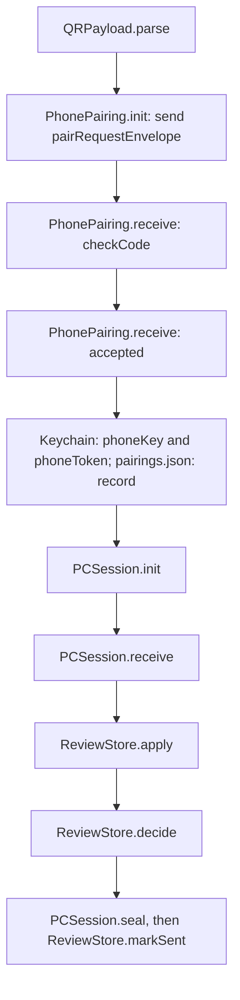

# LastideKit public API

`LastideKit` holds the phone's side of the Lastide phone protocol, version 1. `docs/protocol.md` is the contract. The package imports swift-crypto's `Crypto` module, which re-exports CryptoKit on iOS and builds the same API on Linux.

Every time in this API is an `Int` count of milliseconds since 1970. Every `now:` argument is the phone's clock. The package keeps no clock and no disk state of its own. The app stores the values the package returns.

## The phone's flow



## Protocol values

### `enum LastideProtocol`

The fixed values of protocol version 1 (Table 2).

```swift
static let version: UInt8                       // 1
static let webSocketSubprotocol: String         // "lastide-relay.1"
static let schemaRevision: Int                  // 1
static let ciphersuite: HPKE.Ciphersuite        // Curve25519_SHA256_ChachaPoly
static let headerSize: Int                      // 76
static let tagSize: Int                         // 16
static let smallestEnvelope: Int                // 92
static let largestEnvelope: Int                 // 262_144
static let largestPlaintext: Int                // 262_052
static let largestControlFrame: Int             // 32_768
static let seqLimit: UInt64                     // 2^53
static let largestInteger: Int                  // 2^53 - 1
static let outboxResendAgeMs: Int               // 518_400_000, 6 days
static let disclosureID: String                 // "outside-ai-v1"
static let disclosureText: String               // the disclosure the phone shows before the first scan
static let largestEditText: Int                 // 500 code points
```

### `enum Base64URL`

Base64url without padding, with the protocol's strict decoding rules.

```swift
static func encode<Bytes: DataProtocol>(_ bytes: Bytes) -> String
static func decode(_ text: String) throws -> Data                    // throws Base64URLError
static func decode(_ text: String, byteCount: Int) throws -> Data
```

### `enum Base64URLError: Error`

Why a base64url string was refused: `notCanonical`, `wrongLength(expected: Int, actual: Int)`.

### `struct DeviceID: Hashable, Codable`

A 16-byte device id. Codable as its base64url text.

```swift
init(bytes: Data) throws
init(base64url: String) throws
static let pc: DeviceID                          // 16 zero bytes
static func random() -> DeviceID                 // never all zero
let bytes: Data
var base64url: String
```

### `struct PairingID: Hashable, Codable`

The 16 bytes that name one PC's room. Codable as its base64url text.

```swift
init(bytes: Data) throws
init(base64url: String) throws
let bytes: Data
var base64url: String
```

### `struct PairingTicket: Hashable`

The 16 bytes of one QR code's ticket.

```swift
init(bytes: Data) throws
let bytes: Data
var base64url: String
```

### `func makeMessageID() -> String`

A fresh sync message id: base64url of 16 random bytes.

## Envelopes

### `enum EnvelopeKind: UInt8`

Byte 1 of the envelope: `pairRequest` (1), `pairReply` (2), `message` (3), `push` (4).

### `struct EnvelopeFlags: OptionSet`

Byte 2 of the envelope: `.mailbox` (bit 0) and `.replyKey` (bit 1).

### `enum EnvelopeError: Error`

Why a header was refused: `badSize(Int)`, `badVersion(UInt8)`, `badKind(UInt8)`, `badFlags(UInt8)`, `badSlot(UInt8)`, `badSeq(UInt64)`, `badEncapsulatedKey`.

### `struct EnvelopeHeader: Hashable`

The 76-byte clear header, the AEAD's associated data. The app uses it for the diagnostics block.

```swift
init(kind: EnvelopeKind, flags: EnvelopeFlags, slot: UInt8, sender: DeviceID, recipient: DeviceID, seq: UInt64, enc: Data) throws
init(frame: Data) throws                         // reads a whole frame; checks size, version, kind, flags, slot and seq
let kind: EnvelopeKind
let flags: EnvelopeFlags
let slot: UInt8
let sender: DeviceID
let recipient: DeviceID
let seq: UInt64
let enc: Data
var bytes: Data                                  // 76 bytes
```

### `struct SealedEnvelope: Hashable`

One sealed envelope, ready to send as one binary frame.

```swift
let bytes: Data
let seq: UInt64                                  // the seq that stored and dropped frames quote
```

### `struct SequenceCounter: Hashable, Codable`

One device's send counter: `seq = max(lastSentSeq + 1, now)`. `PCSession` uses it for the app.

```swift
init(lastSentSeq: UInt64)
private(set) var lastSentSeq: UInt64
mutating func next(now: Int) throws -> UInt64   // throws EnvelopeError.badSeq at 2^53
```

## Pairing

### `enum QRError: Error`

Why a scanned string is not a usable pairing code: `otherVersion`, `notPairingCode`.

```swift
var displayText: String     // "Update the Lastide app to pair with this PC." or "This is not a Lastide pairing code."
```

### `struct QRPayload`

The checked content of one pairing QR code. The QR string holds no time. The relay refuses an expired ticket with close code 4401, and `RelayCloseCode.unauthorized.displayText(pairing: true)` gives the sentence.

```swift
static func parse(_ text: String, relayOrigins: [String]) throws -> QRPayload   // throws QRError
let pcKey: Curve25519.KeyAgreement.PublicKey
let pairingID: PairingID
let ticket: PairingTicket
let relayOrigin: String
let pairingIDText: String                        // p as the QR code wrote it
var socketURL: URL                               // wss://<host>[:port]/api/relay/<p>
```

`relayOrigins` is the build setting `LASTIDE_RELAY_ORIGINS`. Each entry must be a lowercase `https` origin without a path, a trailing slash or `:443`. `parse` stops the app on a bad entry, because the build is wrong.

### `struct PhonePairing`

The phone's side of one pairing, from the pair request to `pair-accept` or `pair-refuse`.

```swift
init(payload: QRPayload, deviceName: String, model: String, app: AppInfo, consentAcceptedAt: Int, now: Int) throws
let payload: QRPayload
let phoneID: DeviceID
let phoneKey: Curve25519.KeyAgreement.PrivateKey
let pairRequestEnvelope: Data                    // the pairing socket's one binary frame, after helloPairing
let h1: Data
let pairRequestSeq: UInt64
mutating func receive(_ frame: Data, now: Int) throws -> PairingEvent   // throws PairingError for a dropped frame
```

`deviceName` is `UIDevice.current.name`, and `model` is `utsname.machine`. `init` throws `ValidationError` when either breaks the schema.

### `enum PairingEvent`

What one pair reply changed.

```swift
case checkCode(CheckCode)             // show "Type this code on your PC" and code.display
case accepted(PairingResult)          // store the record and both Keychain items, then connect as phone
case refused(PairRefuseReason)        // show reason.displayText
```

### `enum PairingError: Error`

Why the phone dropped a pairing frame and keeps waiting: `unexpectedFrame(String)`, `openFailed`, `badMessage(String)`, `wrongPairing`.

### `struct CheckCode: Hashable`

The 6-digit check code.

```swift
let digits: String          // "714390"
var display: String         // "714 390"
```

### `struct PairingResult`

A finished pairing.

```swift
let record: PairingRecord
let phoneKey: Curve25519.KeyAgreement.PrivateKey     // Keychain account "<pairing id>.key", rawRepresentation
let phoneToken: Data                                 // Keychain account "<pairing id>.token", 32 bytes
```

### `struct PairingRecord: Hashable, Codable`

The phone's record of one PC, as `pairings.json` holds it.

```swift
var pairingId: PairingID
var relayOrigin: String
var pcKey: String                    // base64url
var pcName: String
var pcSchema: Int
var phoneId: DeviceID
var pairedAt: Int
var pcLastSeenAt: Int?
var lastSentSeq: UInt64
var lastRecvSeq: UInt64
var features: [Feature]
func pcPublicKey() throws -> Curve25519.KeyAgreement.PublicKey
var socketURL: URL
```

## The session

### `struct PCSession`

The phone's sealed channel to one paired PC. Write `record` to `pairings.json` after every call that changes it.

```swift
init(record: PairingRecord, phoneKey: Curve25519.KeyAgreement.PrivateKey) throws
private(set) var record: PairingRecord
var waitingReplyKeyCount: Int
mutating func seal(_ message: SyncMessage, now: Int) throws -> SealedEnvelope
mutating func receive(_ frame: Data, now: Int) -> ReceiveOutcome
mutating func makeEvidenceRequest(draftID: String, storeVersion: Int, now: Int) -> EvidenceRequest
mutating func dropReplyKeys()
mutating func notePCSchema(_ schema: Int)
mutating func notePCLastSeen(at time: Int)
```

`seal` takes `decision`, `sync`, `evidence-request`, `unpair` and `error`, and stops the app on any other type. It raises `record.lastSentSeq`. Write the record before sending the bytes. `makeEvidenceRequest` keeps a reply key in memory, and the app wraps the result in `.evidenceRequest` and seals it. Call `dropReplyKeys` when the detail screen closes and when the app leaves the screen. Call `notePCSchema` with `schema` from each snapshot, and `notePCLastSeen(at:)` with `pcLastSeenAt` of `welcome` or the phone's clock at a `presence` frame.

### `enum ReceiveOutcome`

What the phone does with one binary frame from the PC.

```swift
case ignored(String)                                  // drop silently
case duplicate(ReceivedReport)                        // send report.controlFrame and stop
case message(SyncMessage, ReceivedReport)             // apply, write the record, send report.controlFrame
case unusable(reply: ErrorMessage?, ReceivedReport)   // seal and send reply if not nil, write the record, send report.controlFrame
```

### `struct ReceivedReport: Hashable`

The `received` control frame after an envelope.

```swift
let from: DeviceID
let upTo: UInt64
var controlFrame: String
```

## Relay control frames

### `enum ControlFrame`

Builds and parses the control frames the phone uses.

```swift
static let ping: String                                            // "ping", every 30 s
static func helloPhone(device: DeviceID, token: Data) -> String
static func helloPairing(ticket: PairingTicket) -> String
static func received(from: DeviceID, upTo: UInt64) -> String
static func parse(_ text: String) throws -> RelayFrame             // throws ControlFrameError
```

### `enum RelayFrame: Hashable`

A control frame from the relay.

```swift
case welcome(Welcome)
case presence(device: DeviceID, online: Bool)
case ok(rid: String)
case refused(rid: String?, code: String)      // rid is nil when the refused frame carried no valid rid
case stored(to: DeviceID, seq: UInt64)
case dropped(to: DeviceID, seq: UInt64, reason: String)
case pong
```

### `struct Welcome: Hashable`

The `welcome` fields a version 1 phone reads. Unknown fields are ignored. `ControlFrame.parse` refuses a `welcome` of role `phone` or `pairing` without `pcOnline`, with `badField("pcOnline")`. So `pcOnline` is never nil for those roles.

```swift
let role: String
let device: DeviceID?
let features: [String]
let pcOnline: Bool?
let pcLastSeenAt: Int?
let mailbox: Int
```

### `enum ControlFrameError: Error`

Why a relay frame was refused: `tooLarge`, `notJSON`, `unknownOp(String)`, `badField(String)`.

### `enum RelayCloseCode: Int`

A WebSocket close code from the relay: `normal` (1000), `badFrame` (4400), `unauthorized` (4401), `attestationRefused` (4402), `forbidden` (4403), `roomGone` (4404), `timeout` (4408), `replaced` (4409), `revoked` (4410), `tooLarge` (4413), `unsupportedVersion` (4426), `rateLimited` (4429), `relayError` (4500), `pcOffline` (4503).

```swift
func displayText(pairing: Bool) -> String?    // the sentence of Table 17, or nil when the phone only logs the code
var reconnects: Bool
```

### `struct ReconnectBackoff: Hashable`

The reconnect wait: 1 s, doubled after each try, up to 5 minutes.

```swift
init()
private(set) var nextWaitMs: Int
mutating func take() -> Int
mutating func reset()
```

## Sync messages

### `enum SyncMessage: Hashable`

One sync message, checked against every constraint of section 7.3.

```swift
case pairRequest(PairRequest), pairReceived(PairReceived), pairAccept(PairAccept), pairRefuse(PairRefuse)
case queue(QueueSnapshot), library(LibrarySnapshot), counts(Counts), evidence(Evidence), acknowledgement(Acknowledgement)
case decision(Decision), sync(SyncRequest), evidenceRequest(EvidenceRequest), unpair(Unpair), error(ErrorMessage), notice(Notice)
static func decode(_ plaintext: Data) throws -> SyncMessage    // throws MessageDecodingError
func encoded() throws -> Data                                  // throws ValidationError
func validate() throws
var type: MessageType
var id: String
var sentAt: Int
```

### `enum MessageType: String`

A sync message `type`, with its route from Table 20.

```swift
var kind: EnvelopeKind
var direction: Direction
var flags: EnvelopeFlags
var slot: UInt8
```

### `enum Direction`

Who sends a type: `phoneToPC`, `pcToPhone`, `both`.

### `struct MessageDecodingError: Error`

Why a plaintext could not be used.

```swift
let code: ErrorCode          // badMessage or unknownType
let detail: String
let messageID: String?
let type: String?
```

### `struct ValidationError: Error`

A message that broke one constraint: `let path: String`, `let rule: String`.

### Message types

Each message type is `Hashable` and `Codable`, and holds `id: String` and `sentAt: Int`. The app reads them and builds only `SyncRequest` and `Unpair`.

| Type | Fields |
| --- | --- |
| `PairRequest` | `ticket`, `phoneId`, `phoneKey`, `deviceName`, `model`, `app: AppInfo`, `schema`, `consent: Consent` |
| `PairReceived` | `pairingId`, `phoneId` |
| `PairAccept` | `pairingId`, `phoneId`, `phoneToken`, `pcName`, `schema`, `features: [Feature]` |
| `PairRefuse` | `pairingId`, `phoneId`, `reason: PairRefuseReason` |
| `QueueSnapshot` | `schema`, `storeVersion`, `omitted`, `drafts: [Draft]` |
| `LibrarySnapshot` | `schema`, `storeVersion`, `omitted`, `rules: [Rule]` |
| `Counts` | `schema`, `storeVersion`, `repeatCorrectionsThisWeek`, `repeatCorrectionsLastWeek`, `rulesApproved`, `violationsThisWeek`, `draftsToday`, `draftCap`, `weeks: [WeekCount]` |
| `Evidence` | `requestId`, `draftId`, `changedAtStoreVersion`, `rationale: String?`, `items: [EvidenceWords]` |
| `Acknowledgement` | `decisionId`, `result: AcknowledgementResult`, `appliedAt: Int?`, `reason: RefusalReason?`, `storeVersion`, `current: CurrentItem?` |
| `Decision` | `decisionId`, `target: Target`, `storeVersion`, `action: DecisionAction`, `text: String?`, `scopeOptionId: String?`, `decidedAt` |
| `SyncRequest` | `schema`, `have: SnapshotVersions` |
| `EvidenceRequest` | `draftId`, `storeVersion`, `replyKey` |
| `Unpair` | No other field |
| `ErrorMessage` | `inReplyTo: String?`, `code: ErrorCode`, `detail` |
| `Notice` | `storeVersion`, `queueCount`, `draft: NoticeDraft?` |

```swift
SyncRequest.init(id: String, sentAt: Int, schema: Int, have: SnapshotVersions)
Unpair.init(id: String, sentAt: Int)
```

### Items

| Type | One line | Fields |
| --- | --- | --- |
| `Draft: Identifiable` | A rule text that waits in the review queue | `id`, `changedAtStoreVersion`, `draftKind`, `text`, `scope`, `scopeOptions`, `group: RuleGroup`, `strength`, `agents`, `desktopOnly`, `evidence: [EvidenceItem]`, `evidenceCount`, `sessionCount`, `projectCount`, `leftOutCount`, `relatedRuleIds`, `createdAt` |
| `Rule: Identifiable` | A rule the person approved | `id`, `changedAtStoreVersion`, `text`, `scope`, `scopeOptions`, `group`, `strength`, `agents`, `source`, `state`, `approvedAt: Int?`, `editedAt: Int?`, `editedOn: EditedOn?`, `correctionsBeforeApproval`, `violationsSinceApproval`, `violationsLast30Days`, `lastSeenAt: Int?`, `folderGone`, `desktopOnly` |
| `Scope` | Where an item applies | `kind: ScopeKind` (JSON `scope`), `kindOfWork: String?`, `projectNames: [String]` |
| `ScopeOption` | One scope the person may pick | `id`, `scope: Scope` |
| `EvidenceItem` | One correction behind a draft, without words | `id`, `at`, `projectName`, `agent`, `signal` |
| `EvidenceWords` | The words of one evidence item | `evidenceId`, `state: EvidenceState`, `words: String?` |
| `Target` | The item a decision acts on | `targetType: TargetType`, `id`; `init(targetType: TargetType, id: String)` |
| `CurrentItem` | The item an acknowledgement carries | `case draft(Draft)`, `case rule(Rule)`; `var target: Target` |
| `WeekCount` | One week of the Learning charts | `weekStart`, `repeatCorrections`, `violations` |
| `AppInfo` | The app's version and build | `version`, `build`; `init(version: String, build: Int)` |
| `Consent` | Agreement to the disclosure | `disclosure`, `acceptedAt` |
| `NoticeDraft` | The short draft of a phase 7 notice | `id`, `changedAtStoreVersion`, `draftKind`, `text`, `scope` |
| `SnapshotVersions` | The store versions `sync.have` sends | `queue: Int?`, `library: Int?` |

### Enums

Each is a `String` raw value enum, `Codable` and `CaseIterable`.

| Type | Values |
| --- | --- |
| `Agent` | `claudeCode`, `codex` |
| `DraftKind` | `new`, `rewrite`, `merge`, `contradiction`, `generalize`, `hook`, `import`, `reconfirm` |
| `RuleGroup` | `honesty`, `beforeActing`, `whenStuck`, `writing`, `documents`, `files`, `other` |
| `Strength` | `preference`, `hardLimit` |
| `Signal` | `typedTurn`, `midTurnMessage`, `afterInterrupt`, `refusalComment`, `rewind`, `reviewComment`, `quoteReply`, `fileEdit`, `instructionFileEdit`, `agentInstructionFileWrite`, `promptHistory` |
| `ScopeKind` | `thisProject`, `kindOfWork`, `everyProject` |
| `RuleSource` | `learned`, `imported`, `builtIn` |
| `RuleState` | `on`, `off`, `escalated` |
| `EditedOn` | `desktop`, `phone` |
| `Feature` | `mailbox`, `push` |
| `EvidenceState` | `words`, `removed`, `excluded` |
| `DecisionAction` | `approve`, `saveEdit`, `reject`, `delete`, `edit`, `turnOff`, `turnOn`; `func fits(_ targetType: TargetType) -> Bool` |
| `TargetType` | `draft`, `rule` |
| `ErrorCode` | `badMessage`, `unknownType` |
| `AcknowledgementResult` | `applied`, `refused` |
| `RefusalReason` | `expired`, `gone`, `desktopOnly`, `staleVersion`, `invalidAction`, `invalidText`, `invalidScope`; `var displayText: String` (Table 22) |
| `PairRefuseReason` | `wrongCode`, `expired`, `twoPhones`, `cancelled`, `tooManyPhones`; `var displayText: String` (Table 7) |

## Queue and library state

### `struct ReviewStore: Hashable`

The phone's queue and library state for one PC: snapshots, filters, the outbox and acknowledgements. Write `cache` to the cache file and `outbox` to the outbox file after each change.

```swift
init(cache: ReviewCache, outbox: [OutboxEntry])
static func demo() throws -> ReviewStore         // demo mode, from the bundled fixtures
private(set) var cache: ReviewCache
private(set) var outbox: [OutboxEntry]
let isDemo: Bool

var drafts: [Draft]                               // newest first
var rules: [Rule]                                 // newest approval first
var counts: Counts?
var omittedDrafts: Int
var omittedRules: Int
var badgeCount: Int                               // drafts plus omitted
var have: SnapshotVersions                        // for SyncRequest
func drafts(_ filter: QueueFilter) -> [Draft]
func draft(id: String) -> Draft?
func rule(id: String) -> Rule?
func status(of target: Target) -> ItemStatus
func seenAt(_ target: Target) -> Int?

@discardableResult
mutating func apply(_ message: SyncMessage) -> AcknowledgementOutcome?
mutating func decide(_ target: Target, action: DecisionAction, text: String?, scopeOptionId: String?, now: Int) throws -> Decision
func decisionsToSend(now: Int) -> [Decision]
mutating func markSent(decisionId: String, seq: UInt64, now: Int)
mutating func apply(relayFrame frame: RelayFrame)
```

- `apply(_:)` replaces a snapshot when its store version is equal or higher, and returns an outcome only for `acknowledgement`.
- `decide` throws `ReviewError` for a decision that Table 21 does not allow. A live store adds the decision to the outbox. A demo store applies it to its own copy and leaves the outbox empty.
- After each `welcome`, send `decisionsToSend(now:)`. Seal each one with `PCSession.seal(.decision(d), now:)` and call `markSent` with the envelope's `seq`.
- Pass every `stored` and `dropped` frame to `apply(relayFrame:)`.

### `struct ReviewCache: Hashable, Codable`

The newest snapshots the phone keeps for one PC.

```swift
init()
var queue: QueueSnapshot? { get }
var library: LibrarySnapshot? { get }
var counts: Counts? { get }
```

### `struct OutboxEntry: Hashable, Codable`

One decision that waits for its acknowledgement.

```swift
let decision: Decision
var lastSentAt: Int? { get }
var lastSeq: UInt64? { get }
var stored: Bool { get }
var droppedReason: String? { get }     // for the diagnostics block
```

### `enum QueueFilter: String, CaseIterable`

A filter chip: `all`, `new`, `rewrite`, `conflict`. `var label: String` gives "All", "New", "Rewrite" or "Conflict".

### `enum ItemStatus: Hashable`

What a card shows about its item's actions.

```swift
case ready, desktopOnly, notSent, waitingForPC, refused(RefusalReason)
var displayText: String?      // "Not sent yet", "Waiting for your PC", "Approve this one on your PC", or the refusal's sentence
var allowsActions: Bool
```

### `enum AcknowledgementOutcome: Hashable`

What an acknowledgement changed: `applied(Target)`, `refused(Target, RefusalReason)`, `alreadyHandled`.

### `enum ReviewError: Error`

Why the phone refused to build a decision: `unknownItem`, `desktopOnly`, `decisionPending`, `actionDoesNotFit`, `importedRule`, `invalidText`, `invalidScope`.

### `enum ReviewText`

Fixed sentences of the review screens.

```swift
static let draftedOnPC: String                 // "Drafted on your PC"
static let appearsWhileOnline: String          // "Appears while your PC is online"
static func moreOnPC(_ omitted: Int) -> String // "3 more on your PC"
static func evidenceLine(_ draft: Draft) -> String   // "3 corrections, 2 projects"
```

### `struct DemoFixtures`

The bundled synthetic messages of demo mode, in `Sources/LastideKit/Resources/Demo/`.

```swift
static func load() throws -> DemoFixtures
static func plaintext(_ name: String) throws -> Data     // "queue", "library" or "counts"
let queue: QueueSnapshot
let library: LibrarySnapshot
let counts: Counts
```

### `enum DemoFixtureError: Error`

Why a fixture could not load: `missing(String)`, `wrongType`.
