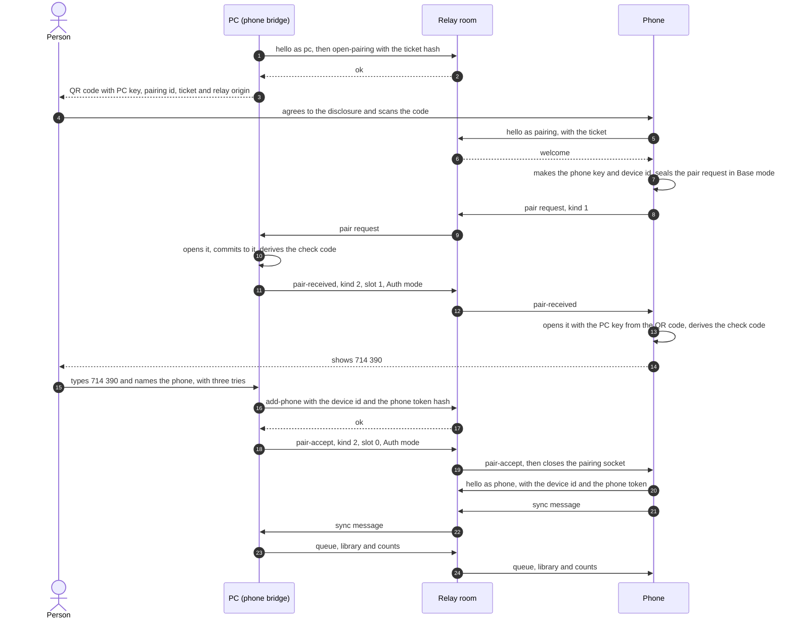
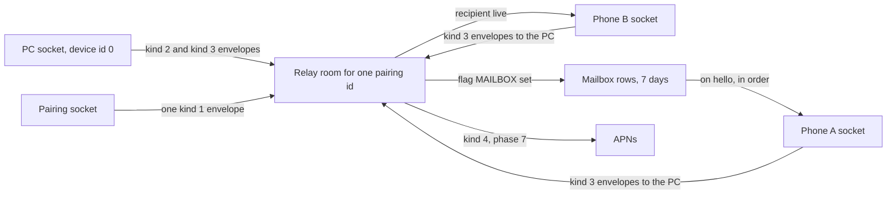

# Lastide phone protocol, version 1

This document fixes every byte that passes between three programs. The first is the Lastide desktop app on a PC. The second is the relay in the site Worker. The third is the Lastide app on an iPhone.
Three engineers build from this document alone. One writes the Swift package `LastideKit`, one writes the phone bridge, and one writes the relay.

## Answer first

- Each message is sealed end to end with HPKE ([RFC 9180][rfc9180]) in one suite: DHKEM(X25519, HKDF-SHA256), HKDF-SHA256, ChaCha20Poly1305.
- Pairing takes three sealed messages and one typed code. The phone seals its key to the PC's key in Base mode. The PC commits to that one request and answers in Auth mode.
- Both devices derive a 6-digit check code from the exporter of the PC's first answer. The phone shows the code only after that answer arrives. The person types the code on the PC, and three wrong entries void the pairing.
- Every later message gets its own HPKE context in Auth mode. A sequence number per sender stops replays.
- A 76-byte header travels in clear with each message and is the AEAD's associated data. The relay routes on the header and cannot read or change the rest.
- The relay is one Durable Object per PC at `/api/relay/<pairing id>`. Each socket proves its role in its first frame with a random room token. The relay stores only SHA-256 hashes of tokens.
- A flag in the header marks the messages the relay may keep for 7 days while the recipient is offline. Evidence words never carry that flag, and they travel sealed to a one-time reply key.
- Phase 7 adds push notifications, a widget and App Attest (section 9). Version 1 code already handles the envelope kind, the control frames and the welcome fields that phase 7 uses.

## Contents

- [Decisions this protocol rests on](#decisions-this-protocol-rests-on)
- [Terms](#terms)
- [Notation and constants](#notation-and-constants)
- [1. Threat model](#1-threat-model)
- [2. Keys and identities](#2-keys-and-identities)
- [3. The QR payload](#3-the-qr-payload)
- [4. Pairing](#4-pairing)
- [5. The session](#5-the-session)
- [6. The relay](#6-the-relay)
- [7. Sync messages](#7-sync-messages)
- [8. Demo mode and the demo room](#8-demo-mode-and-the-demo-room)
- [9. Phase 7: push, the widget and App Attest](#9-phase-7-push-the-widget-and-app-attest)
- [10. Test vectors](#10-test-vectors)
- [Sources](#sources)

## Decisions this protocol rests on

Table 1. The protocol takes two plan decisions as recommended and adds one decision that the plan does not hold yet.

| Decision | What the protocol does | State |
| --- | --- | --- |
| Plan decision 11: the mailbox | The relay keeps encrypted drafts, rules, decisions and acknowledgements for 7 days while a device is offline. Evidence words and learning counts travel only live. Section 6.9 lists every field that enters the mailbox and gives the `/privacy` sentence | Taken as the plan recommends. The plan's wording names rule text, scope, dates and project names. Each record in the mailbox also holds its ids, enum values and its own counters, and the plan's decision row must name them too |
| Plan decision 12: decisions while Lastide is closed | The PC applies waiting decisions at the next app start, and the phone shows "Waiting for your PC" | Taken as the plan recommends |
| Room creation needs a signed-in Lastide account on the PC | Section 4.1. The account caps rooms at 5 and lists them for deletion | Proposed by this protocol. The plan's decision table does not hold it yet |

## Terms

Each term keeps one meaning in this document.

| Term | Meaning |
| --- | --- |
| PC | The person's computer that runs the Lastide desktop app |
| Phone | An iPhone that runs the Lastide app |
| Phone bridge | The part of the desktop app's main process that speaks this protocol |
| Rule learning service | The desktop process that owns the rule store, applies decisions and keeps the store version |
| Relay | The Worker code under `/api/relay/` that forwards frames between one PC and its phones |
| Durable Object | A Cloudflare Workers object with one name, its own storage and one thread. Each room is one |
| Room | The relay's state for one PC: one SQLite-backed Durable Object |
| Demo room | A room that the Worker marks at creation for App Review. A demo room serves synthetic data only (section 8) |
| Pairing id | 16 random bytes that name one PC's room. Every phone of that PC uses the same pairing id |
| Pairing | The link of one phone to one PC, made once by QR code and check code |
| Pairing ticket | 16 random bytes in one QR code. The ticket lets one phone open a pairing socket within 120 s |
| Check code | The 6-digit code that both devices derive from the exporter of the `pair-received` context during pairing |
| PC key | The PC's static X25519 key pair |
| Phone key | The phone's static X25519 key pair for one pairing |
| PC token, phone token | 32 random bytes that admit a socket to the room. The relay keeps their SHA-256 hashes |
| Device id | 16 bytes that name a sender or a recipient in the room. The PC's device id is 16 zero bytes |
| Envelope | One sealed message: a 76-byte header followed by HPKE ciphertext |
| Envelope kind | Byte 1 of the envelope: pair request, pair reply, message or push. The word "kind" alone always means the envelope kind |
| Pair reply | A kind 2 envelope from the PC to a new phone: `pair-received`, `pair-accept` or `pair-refuse` |
| Seq | The sender's sequence number in the envelope header |
| Control frame | A JSON text frame between a device and the relay. The relay reads it |
| Sync message | The JSON plaintext inside an envelope. Only the two devices read it |
| Mailbox | Envelopes that the relay keeps for an offline recipient, for at most 7 days |
| Slot | Byte 3 of the envelope. In a mailbox envelope, a newer envelope in the same slot replaces the older one. In a pair reply, slot 1 marks `pair-received` |
| Reply key | A one-time X25519 key pair that the phone makes for one `evidence-request`. The PC seals the evidence words to it |
| Presence | The relay's report that a peer device came online or went offline |
| Outbox | The phone's list of decisions that wait for their acknowledgement |
| Draft | A rule text that waits in the review queue on the PC |
| Rule | A rule the person approved. Lastide writes it into the agents' instruction files |
| Store version | The rule learning service's counter, raised on every write to the rule store. Each snapshot carries it |
| `changedAtStoreVersion` | The store version at an item's last change. Each draft and each rule carries it |
| Decision | A phone's action on one draft or one rule |
| Acknowledgement | The PC's answer to one decision: applied or refused |
| Evidence words | The redacted words of the corrections behind a draft. They reach the phone only while both devices are online |
| Learning counts | The numbers and weekly series of the Learning screen |
| Schema revision | The version of the sync message JSON. This document defines revision 3. Each revision only adds to the one before. So every revision 1 or 2 message is also a revision 3 message |
| HPKE | Hybrid Public Key Encryption, [RFC 9180][rfc9180] |
| AEAD | Authenticated encryption with associated data. The cipher encrypts the plaintext and authenticates both the plaintext and the associated data |
| Base mode | HPKE mode `0x00`. The recipient learns nothing about who sealed the message |
| Auth mode | HPKE mode `0x02`. Opening succeeds only when the sender held the expected static private key |
| `enc` | The 32-byte encapsulated key that HPKE's sender makes for each context |
| Exporter | HPKE's `Export(exporter_context, L)`, which derives L bytes from a context's exporter secret |
| Phase 7 | The later work that adds push notifications, the widget and App Attest |
| APNs | Apple Push Notification service, which delivers pushes to an iPhone |
| Notification service extension | An app extension that iOS runs to change a push's content before it shows. Phase 7 uses it to decrypt |
| App Group | A shared container that an app and its extensions can all read |
| App Attest | Apple's service that proves a request comes from a real copy of the app on a real device |
| Device token | The token iOS gives the app for its alert and background pushes. The relay stores it as `alert_token` |
| Widget token | The token WidgetKit gives the widget extension for widget pushes. The relay stores it as `widget_token` |
| Push environment | `sandbox` or `production`: the APNs host that a device token belongs to |
| Alert notice | A kind 4 envelope in slot 0 that holds a `notice`. The relay sends it as an alert push |
| Count update | A kind 4 envelope in slot 1 that holds a `count-update`. The relay sends it as a background push |
| Widget push | A WidgetKit push that the relay sends by itself 30 s after an alert notice |
| Provider token | The ES256 JSON Web Token that authorizes the relay at APNs |
| Exempt room | A room whose creating account sat in the D1 table `attest_exempt` when the room was made. `RELAY_REQUIRE_ATTEST` does not apply to it |
| DPAPI | The Windows Data Protection API. DPAPI encrypts data with keys tied to the person's Windows login |

## Notation and constants

- `||` joins byte strings. `"text"` in a byte formula means the ASCII bytes of that text, without a terminator.
- Every integer inside a binary format is unsigned and big-endian.
- `SHA-256(x)` is the 32-byte digest of x.
- base64url means the [RFC 4648, section 5][rfc4648] alphabet without padding. Decoders refuse padding, characters outside the alphabet, and a final character whose unused bits are set. 16 bytes take 22 characters, and 32 bytes take 43.
- A time is an integer count of milliseconds since 1970-01-01T00:00:00Z. Every integer in JSON stays below $2^{53}$, so JSON numbers hold it exactly.
- Text is UTF-8 without a byte order mark. JSON length limits count Unicode code points, as JSON Schema's `maxLength` does.

Table 2. Version 1 fixes every size and limit, so the three programs agree without negotiating.

| Name | Value |
| --- | --- |
| Protocol version | `1`: envelope byte 0, the `1` in `lastide-pair:1`, and `v` in control frames |
| WebSocket subprotocol | `lastide-relay.1` |
| HPKE KEM | `0x0020`, DHKEM(X25519, HKDF-SHA256). `Nenc` = `Npk` = `Nsk` = 32 bytes |
| HPKE KDF | `0x0001`, HKDF-SHA256 |
| HPKE AEAD | `0x0003`, ChaCha20Poly1305. `Nk` = 32, `Nn` = 12, `Nt` = 16 bytes |
| PC device id | 16 bytes of `0x00`, base64url `AAAAAAAAAAAAAAAAAAAAAA` |
| Envelope header | 76 bytes |
| Largest envelope | 262,144 bytes (256 KiB), header included |
| Largest plaintext | 262,052 bytes. The PC keeps snapshots under 240,000 bytes |
| Largest control frame | 32,768 bytes of UTF-8 |
| Largest push envelope (phase 7) | 2,800 bytes |
| Push limits (phase 7) | 1 alert notice a minute and 1 count update in 20 minutes, per phone |
| QR code life | 120 s from the moment the PC opens the ticket. A demo room's ticket lives up to 90 days |
| Code entry window | 300 s from the moment the PC sends `pair-received` |
| Wrong codes before the pairing ends | 3 |
| Mailbox life | 7 days, 604,800,000 ms |
| Mailbox size | 1,000 envelopes and 4 MiB for each sender and recipient pair |
| Decision age limit | 8 days, 691,200,000 ms, measured from the decision envelope's `seq` |
| Sockets waiting for `hello` | 4 per room and 2 per client address |
| Frames per socket | 500 a second |
| Phones per PC | 8 |
| Rooms per account | 5 |
| Room life without a PC connection | 90 days |
| Sync schema revision | 3 |

## 1. Threat model

### 1.1 What the protocol protects

The protocol protects five things:

1. Rule text, draft text, scopes, project names and dates.
2. Evidence words, the most sensitive text, because they quote the person.
3. Learning counts.
4. The right to approve, edit, turn off and delete rules on the PC.
5. The pairing itself: only a phone the person chose may join.

The relay must keep rooms available, but the protocol cannot force an operator to do so.

### 1.2 Who can do what

Table 3. A party sees metadata at most unless it holds a private key. The check code stops a stranger from pairing.

| Party | Can | Cannot |
| --- | --- | --- |
| The relay, its operator, or anyone who takes over the Worker or its storage | See IP addresses, times and sizes of all frames. See the pairing id, device ids, envelope kinds, flags, slots and seq values. See which devices are online, and which account created the room. See the tokens in hello frames and the stored token hashes. Drop, delay, withhold or replay frames. Delete the mailbox or the room. In phase 7, push any notification text to a paired phone, because the Worker holds the APNs key | Read a pairing message or a sync message. Change a frame unnoticed, because the header is the AEAD's associated data. Pose as the PC or as a paired phone, because Auth mode checks static keys. Pair a phone without the QR code and the person's typed code. Search for a pair request that matches a code it saw. The code exists only after the PC commits to one request. Learn the check code or any HPKE key. Read evidence words at rest or from a recording. They never enter the mailbox, and the phone deletes their reply key. Get a held decision applied more than 8 days after the phone sent it. Make a notification action act on fields that the extension did not open. Make an action act under text that the extension did not set |
| A network attacker between a device and the relay | See that a device talks to the relay, when, and how much. Block traffic | Read hello frames or envelopes, because TLS covers them. With a trusted root certificate on the device, the attacker gets the relay's view above and nothing more |
| Someone who photographs the QR code | Within 120 s, open the pairing socket before the person's phone does. That stops the person's pairing, and the person starts again with a new code. Seal messages to the PC key at any time | Complete a pairing. The PC answers one pair request per code. The person's phone shows a code only after the PC answers that phone's own request. A code that the person types matches the attacker's request at most 3 times in 1,000,000 per QR code. Use the ticket after 120 s, or after a phone used it. Join the room, because they lack a token. Get a sealed message accepted. The PC opens only pair requests that answer its open QR code, and Auth-mode messages from paired phones |
| Someone who finds a lost phone, without its passcode | Read notification text on the lock screen in phase 7, unless the person hides previews in iOS settings | Read the cached data, because its files open only while the phone is unlocked. Read the keys while the phone has not been unlocked since its last restart. After the first unlock, the system can read the keys until the next restart. The phase 7 extension needs that to decrypt on a locked phone. Approve or delete from the lock screen, because both actions require an unlocked device |
| Someone who finds a lost phone and knows its passcode | Until the person revokes the phone: read cached drafts and rules. Ask for evidence words while the PC is online. Send decisions. An approval or an edit can carry up to 500 code points of new rule text. Lastide writes that text into the agents' instruction files. So the finder can give instructions to the person's coding agents. A decision sent while Lastide is closed applies at the next app start, before the person can click Revoke. The desktop lists every applied phone decision, live or from the mailbox, until the person clears it. Each entry names the phone, shows the text before and after, and offers Undo and Revoke. A notice points the person to the list | Approve hook templates or deny rules. Change a project file that git may track: a file from before the PC kept its rule files out of git, or the project's own `CLAUDE.md` or `AGENTS.md`. The PC accepts those decisions only on the desktop. Hide text from the person, because the PC refuses hidden code points and `@` file imports (section 7.4, check 7). Act after Revoke on the PC |
| Anyone who holds a revoked phone's keys and token | Read what the phone stored before the revoke. Open the envelopes it recorded before the revoke, except evidence words | Connect, because the relay deleted its token hash. The phone bridge repeats `remove-phone` until the relay confirms it. Receive new messages, because the PC stopped sealing to its key and the relay deleted its mailbox. Get a frame accepted, because the PC deleted its phone key. Pair again without a new QR code on the PC |
| Anyone who knows the pairing id, such as a QR code viewer or a revoked phone | Open sockets to the room that wait for `hello`. Each such socket closes the oldest waiting socket when the room's limit is reached | Join the room, because joining needs a token or an open ticket. Hold a waiting socket for more than 10 s. Hold more than 2 waiting sockets from one client address |
| APNs (phase 7) | See the device token, the time and the size of each push. See the clear envelope header inside `lastide.e`: both device ids, the slot and the seq. The seq is about the PC's clock in ms. See the phone's device id in `thread-id` and `apns-collapse-id` | Read the push body, because the PC seals it to the phone key |

### 1.3 Out of scope

- Malware that runs under the person's login on the PC. Such malware can ask the operating system to decrypt the PC key, because DPAPI protects against other users only.
- A jailbroken phone.
- Traffic analysis by the relay, and denial of service by the relay.

### 1.4 What the design accepts

- Messages other than evidence words do not get forward secrecy. Each context mixes the static keys with a fresh ephemeral key. A thief of a static private key can open captured envelopes that were sealed to that key. Only the relay, or an attacker who breaks TLS, holds captured envelopes. The mailbox keeps them at most 7 days.
- Evidence words get forward secrecy. The PC seals them to a reply key. The phone deletes the reply key's private part when the detail screen closes (section 7.2).
- Auth mode allows key-compromise impersonation ([RFC 9180, section 9.1.1][rfc9180]). A thief of a recipient's private key can forge Auth-mode messages to that recipient. That thief already reads everything sent to the recipient, so the design accepts the risk.
- The relay learns the metadata in Table 3.
- An outsider who knows the pairing id and controls many client addresses can delay connections. Each new waiting socket closes the oldest one, and the relay cannot tell a device's socket from an outsider's before `hello`. A device sends `hello` at once, so the outsider must open sockets faster than a device's first frame arrives.
- In phase 7 a takeover of the Worker can push any notification text, because the Worker holds the APNs key. The actions still act only on an envelope that the app opens again, under the extension's text (section 9.4).

### 1.5 Facts for the export classification

Plan decision 15 sets the app's export classification. These facts are its input, and the classification itself stays with that decision. The app encrypts with standard published algorithms only: RFC 9180 HPKE with X25519, HKDF-SHA256 and ChaCha20-Poly1305. The app calls them through Apple's CryptoKit, and TLS through URLSession. The app does not add a cipher of its own. The encryption protects the person's own rule data between the person's own PC and phone.

## 2. Keys and identities

### 2.1 Every key and secret

Table 4. Each private key stays on the device that made it, and the relay holds hashes only.

| Item | Type | Made by | Made when | Private part lives in | Public part or hash goes to | Life |
| --- | --- | --- | --- | --- | --- | --- |
| PC key | X25519 key pair | Phone bridge, `suite.kem.generateKeyPair()` | First pairing on this PC | The PC's identity file, encrypted by Electron `safeStorage` | Every QR code | Until "Reset Phone Pairing" |
| Phone key | X25519 key pair | Phone, `Curve25519.KeyAgreement.PrivateKey()` | Each scan of a QR code | A Keychain item on the phone | The PC, inside the sealed pair request | Until the pairing ends |
| Ephemeral key | X25519 key pair | The HPKE library, inside Encap | Every envelope | Memory, discarded after sealing | `enc` in the envelope header | One envelope |
| Reply key | X25519 key pair | Phone, `Curve25519.KeyAgreement.PrivateKey()` | Each `evidence-request` | Memory only | The PC, inside the sealed `evidence-request` | Until the detail screen closes or the app leaves the screen |
| PC token | 32 random bytes | Phone bridge | First pairing on this PC | The PC's identity file, encrypted by `safeStorage` | The relay keeps SHA-256 of it | Until "Reset Phone Pairing" |
| Phone token | 32 random bytes | Phone bridge | Each pairing | A Keychain item on the phone. The PC deletes its copy after sending it | The relay keeps SHA-256 of it | Until the pairing ends |
| Pairing ticket | 16 random bytes | Phone bridge | Each QR code | The QR code only | The relay keeps SHA-256 of it | 120 s |

Every random value comes from the platform's cryptographic generator. The PC and the Worker use `crypto.getRandomValues`. The phone uses `SecRandomCopyBytes` or `SystemRandomNumberGenerator`.

### 2.2 Identities

- The pairing id names the room. The phone bridge makes it once, at the first pairing, and every phone of that PC uses it.
- The PC's device id is 16 zero bytes.
- A phone's device id is 16 random bytes that the phone makes when it scans a QR code. A phone refuses an all-zero result and draws again.
- A phone paired with two PCs holds two device ids and two phone keys, one per pairing. The two PCs cannot link the phone through its keys.

### 2.3 Where each private key lives

PC. The phone bridge runs in the desktop app's main process. The phone bridge encrypts the PC key and the PC token with Electron `safeStorage`. The phone bridge calls `safeStorage.encryptStringAsync` and `safeStorage.decryptStringAsync` directly, and never the synchronous calls. Electron's documentation deprecates the synchronous calls and removes them in Electron 46. VS Code's `IEncryptionMainService` still calls them, and the pinned upstream, VS Code 1.138.0, ships Electron 42.10.0.
When `decryptStringAsync` reports `shouldReEncrypt`, the phone bridge encrypts the value again and writes the new string. The phone bridge writes only the encrypted strings to disk. On Windows, `safeStorage` keys come from DPAPI. DPAPI keeps the data from other users of the machine, but other programs of the same user can read it.
The phone bridge refuses to pair when `safeStorage.isAsyncEncryptionAvailable()` resolves to false. On Linux the phone bridge also refuses when `safeStorage` selects the `basic_text` backend, because that backend encrypts with a fixed password.

Phone. The phone stores its private key and its phone token as Keychain items:

- Class `kSecClassGenericPassword`, service `lastide.pairing`, account `<pairing id>.<field>`, where field is `key` or `token`.
- Value: the raw 32 bytes, from `rawRepresentation` for the key.
- `kSecAttrAccessible` = `kSecAttrAccessibleAfterFirstUnlockThisDeviceOnly`. The items open after the first unlock until the next restart. The notification service extension needs that in phase 7, because it decrypts while the phone is locked. The items do not move to a new device.
- `kSecAttrSynchronizable` = false, so the items stay out of iCloud Keychain.
- Phase 7 moves the items into the keychain access group `<Team ID>.dev.lastide.app.shared`. Only the app and its notification service extension hold that group, and the widget does not. Every query from then on names that group.

The Secure Enclave cannot hold the phone key. CryptoKit's `SecureEnclave` offers `P256`, `MLKEM768`, `MLKEM1024`, `MLDSA65` and `MLDSA87` types, and it does not offer an X25519 type. The App Attest key of phase 7 does live in the Secure Enclave, because App Attest makes it there.

### 2.4 Rotation

- Every envelope uses a fresh ephemeral key. Each envelope therefore gets its own AEAD key and nonce.
- The phone key and the phone token change with every pairing. To rotate them, the person ends the pairing on either device and scans a new code.
- "Reset Phone Pairing" deletes the PC key, the pairing id, the PC token and the old room (Table 19). The next "Pair a Phone" makes new ones, and every phone must scan again. The person uses it after a suspected compromise of the PC.
- Version 1 does not rotate keys on a timer. Only the QR code carries the PC key, so a new PC key always needs a new scan.

## 3. The QR payload

### 3.1 Format

The QR code holds one ASCII string:

```text
lastide-pair:1?k=<PC key>&p=<pairing id>&t=<pairing ticket>&r=<relay origin>
```

Table 5. The QR string carries four fields in a fixed order.

| Field | Content | Encoding | Length |
| --- | --- | --- | --- |
| `lastide-pair:` | Scheme | ASCII | 13 characters |
| `1` | Protocol version | ASCII digit | 1 character |
| `k` | PC public key | base64url | 43 characters |
| `p` | Pairing id | base64url | 22 characters |
| `t` | Pairing ticket | base64url | 22 characters |
| `r` | Relay origin: `https://`, the host, and an optional `:port` | Percent-encoded with the rules of JavaScript's `encodeURIComponent` | At most 64 characters after encoding |

Example, from the Lastide test vector of section 10:

```text
lastide-pair:1?k=Ot3-WtJguKG96IqpphPn5Ay56Zmu86xNwiWGVTU3U08&p=NCvG0FBkatktbCilgU7GqA&t=Gs9iGMo0pL0yJjqBIYT9KA&r=https%3A%2F%2Frelay.example
```

### 3.2 Parsing rules on the phone

1. The string starts with `lastide-pair:1?`. Another version number gets "Update the Lastide app to pair with this PC."
2. The string holds exactly the four parameters, in the order `k`, `p`, `t`, `r`, each once.
3. Each of `k`, `p` and `t` decodes canonically to 32, 16 and 16 bytes.
4. `r` decodes to an origin with scheme `https`, a host and an optional port. The origin does not hold a path, a query, a fragment or user information. `r` equals `encodeURIComponent` of the decoded origin, so the phone refuses any other percent encoding.
5. The decoded `r` equals an entry of the app's built-in list of relay origins, byte for byte. Each entry is lowercase, without a trailing slash and without the default port `:443`. The PC writes `r` from the same string, so the match does not need any normalizing.
6. Any other string gets "This is not a Lastide pairing code."

The app builds the socket URL from the decoded origin. The app replaces the leading `https://` with `wss://`, then appends `/api/relay/` and the `p` value as the QR code wrote it. An explicit port stays in the URL.

The list of relay origins is the build setting `LASTIDE_RELAY_ORIGINS` in `project.yml`. The setting sits on one line and separates its origins with single spaces. Until the product's domain exists, the list holds `https://relay.example`, and `scripts/rename-brand/rename.mjs` in the Lastide workspace repository owns that value. A development build adds its test origin from a CI variable or from the git-ignored file `Local.xcconfig`, never from a committed file. Only the Debug configuration reads `Local.xcconfig`, through `Config/Debug.xcconfig`, so a Release build never holds a test origin. The pre-push scan of the iOS repository fails on any `workers.dev` host.

The app does not register the `lastide-pair` scheme with iOS in version 1. The app's own scanner reads the code. So the system camera cannot pass the code to another app that claims the scheme.

### 3.3 Expiry

The QR string does not hold a time, so clock differences between devices do not matter. The relay refuses the ticket 120 s after the PC opens it. The PC refuses a pair request that arrives more than 120 s after it showed the code. The PC shows a countdown and offers "Show a New Code" when the time runs out. The demo room is the one exception: its ticket lives up to 90 days and admits many phones (section 8.2).

### 3.4 Size

The example string has 140 characters. The `qrcode` npm package 1.5.4 encodes it as version 8 at error correction level M: 49 by 49 modules. The longest string the rules allow has 177 characters and needs version 9, 53 by 53 modules. The PC draws level M with a quiet zone of 4 modules. At 4 pixels a module, a version 8 code is 228 pixels wide.

## 4. Pairing

### 4.1 Before the first QR code, the PC creates its room

1. The phone bridge makes the PC key, a pairing id and a PC token.
2. The desktop window sends `POST /api/relay/<pairing id>` with the account's session token and the hash of the PC token (section 6.1). The phone bridge supplies the pairing id and the hash. The session token stays in the window's secret storage, so the phone bridge never holds it.
3. The Worker checks the session and the account's count of live rooms. The Worker refuses a pairing id that any room used before. Then the Worker creates the room.
4. The phone bridge opens its socket as `pc` (section 6.3) and keeps it open while the desktop app runs.

Room creation needs a signed-in Lastide account on the PC. Room creation is the one write that a stranger could otherwise repeat without limit. The account caps that write at 5 live rooms. Lastide Settings and the account page list the account's rooms through `GET /api/relay`, each with Delete. So a person who lost a PC's identity file can free its room. The phone never signs in.

### 4.2 The sequence

Figure 1. Pairing takes three sealed envelopes. The PC commits to one request before any code exists, and the person's typed code joins the two devices.



### 4.3 The steps

1. PC: the person clicks "Pair a Phone" in Lastide Settings. The phone bridge refuses when 8 phones are paired already.
2. PC: the phone bridge makes a pairing ticket and sends `open-pairing` with SHA-256 of the ticket and `ttlMs` 120000. The relay answers `ok`.
3. PC: the phone bridge draws the QR code of section 3 and starts the 120 s countdown.
4. Phone: before the first scan, the app shows the disclosure and asks for agreement. The disclosure reads: "Rules you approve or edit here are used by an outside AI service on your PC. That service checks your later messages against them and drafts changes." Its id is `outside-ai-v1`.
5. Phone: the app scans the code and checks it as section 3.2 says.
6. Phone: the app makes a phone key, a device id and its first seq (section 5.4).
7. Phone: the app opens the socket URL of section 3.2 with subprotocol `lastide-relay.1`. Its first frame is `hello` with role `pairing` and the ticket. The relay checks the ticket, marks it used and sends `welcome`.
8. Phone: the app builds the pair request. The plaintext is the `pair-request` sync message of section 7. The app sets up HPKE in Base mode with the PC key and `INFO_PAIR_REQUEST`. The header carries kind 1, flags 0 and slot 0. The header's sender is the phone's device id, and its recipient is the PC's. The app seals the plaintext with the header as associated data.
9. Phone: the app computes `h1` = SHA-256 of the whole pair request envelope. The app sends the envelope as one binary frame and shows "Waiting for your PC". The app does not show a code yet.
10. Relay: the relay checks that the frame is the socket's first envelope, of kind 1, addressed to the PC. The relay checks that the sender device id is not the PC's and not a paired phone's. The relay ties the sender id to the socket and forwards the envelope to the PC. When the PC is offline, the relay closes the socket with code 4503.
11. PC: the phone bridge drops a pair request that arrives after 120 s or while no QR code is open.
12. PC: the phone bridge opens the envelope in Base mode with the PC key and `INFO_PAIR_REQUEST`. The phone bridge checks the plaintext. `ticket` must equal the open ticket, and `phoneId` must equal the header's sender. `phoneKey` must decode to 32 bytes, and `consent.disclosure` must be `outside-ai-v1`. The phone bridge drops a request that does not open or does not pass these checks. A second request that passes them with a different `enc` ends the pairing (section 4.6). The phone bridge ignores a byte-identical copy of the first request.
13. PC: the phone bridge commits to this request. From now on the phone bridge does not answer another request on this code. The phone bridge sets up an Auth-mode sender context with `INFO_PAIR_REPLY`. The phone key is the recipient, and the PC key is the sender. The phone bridge derives the check code from this context (section 4.5). Then the phone bridge seals the `pair-received` sync message in the same context. The header carries kind 2, flags 0 and slot 1. The header's sender is the PC's device id, and its recipient is the phone's. The phone bridge sends the envelope and starts the 300 s code window.
14. Relay: the relay forwards the kind 2 envelope with slot 1 to the pairing socket with that device id. The socket stays open.
15. Phone: the app opens `pair-received` in Auth mode. The app uses its phone key, `INFO_PAIR_REPLY` and the PC key from the QR code. An open without error proves that the PC holds the PC key and took this phone's request. The app checks that `pairingId` equals the QR code's `p` and that `phoneId` equals its own device id. The app derives the check code from the same context and shows "Type this code on your PC" and the code.
16. PC: the phone bridge asks the person to type the code that the phone shows, and to name the phone. The name field starts with `deviceName` and the date, for example "iPhone 2026-11-18".
17. Person: the person types the code. The phone bridge compares the 6 digits in constant time. A wrong code shows "Wrong code. 2 tries left." The third wrong code ends the pairing.
18. PC, on the right code: the phone bridge makes a phone token. The phone bridge sends `add-phone` with the device id and SHA-256 of the token. The phone bridge waits for `ok`.
19. PC: the phone bridge writes the phone's record (section 4.7). The phone bridge seals the `pair-accept` sync message in a new Auth-mode context with `INFO_PAIR_REPLY`. The header carries kind 2, flags 0 and slot 0. The phone bridge then deletes its copy of the phone token.
20. Relay: the relay forwards the kind 2 envelope with slot 0 to the pairing socket. The relay then closes that socket with code 1000.
21. Phone: the app opens `pair-accept` in Auth mode, as in step 15. The app checks `pairingId` and `phoneId` again, and checks that the `seq` is above the `seq` of `pair-received`. The app stores the pairing and shows "Paired with" and the PC's name, for example "Paired with My PC".
22. Phone: the app connects as `phone` and sends a `sync` message. The PC answers with the queue, the library and the learning counts.

The PC marks the phone's record confirmed when the relay first reports that phone online, in `presence` or in `welcome.phonesOnline`. A message from the phone that opens confirms the record too. A record still unconfirmed after 10 minutes of connected time is removed with `remove-phone`. The 10 minutes count only while the PC's socket is open. A PC that sleeps or quits cannot see the phone come online. The timeout covers a `pair-accept` that never reached the phone.

### 4.4 Info strings and the exporter context

Every HPKE `info` value and the exporter context starts with an ASCII label and one `0x00` byte. No label is a prefix of another label. Every value stays within the 64 bytes that RFC 9180 recommends.

Table 6. Each envelope kind uses its own info string, so an envelope cannot be opened as another kind.

| Name | Bytes | Length | Used by |
| --- | --- | --- | --- |
| `INFO_PAIR_REQUEST` | `"lastide/v1/pair-request" \|\| 0x00 \|\| pairing id` | 40 | Kind 1, Base mode |
| `INFO_PAIR_REPLY` | `"lastide/v1/pair-reply" \|\| 0x00 \|\| h1` | 54 | Kind 2, Auth mode: `pair-received`, `pair-accept` and `pair-refuse` |
| `INFO_MESSAGE` | `"lastide/v1/message" \|\| 0x00 \|\| pairing id` | 35 | Kind 3, Auth mode |
| `INFO_PUSH` | `"lastide/v1/push" \|\| 0x00 \|\| pairing id` | 32 | Kind 4, Auth mode, phase 7 |
| `CHECK_CODE_CONTEXT` | `"lastide/v1/check-code" \|\| 0x00 \|\| h1` | 54 | Exporter context of the `pair-received` context |

`h1` is SHA-256 of the complete pair request envelope: header and ciphertext, 76 + n + 16 bytes. `INFO_PAIR_REPLY` contains `h1`, so a pair reply opens only for the phone that sent that exact pair request.

### 4.5 The check code

The PC derives the code from its `pair-received` sender context. The phone derives it from its `pair-received` recipient context. Both contexts hold the same exporter secret. The PC's fresh ephemeral key enters that secret. The PC makes that key only after it commits to one pair request. So nobody can compute a code before the PC answers. The phone shows a code only for a request that the PC took.

```text
h1      = SHA-256(pair request envelope)                    32 bytes
context = "lastide/v1/check-code" || 0x00 || h1             54 bytes
e       = Export(context, 8) in the pair-received context   8 bytes
n       = e read as an unsigned 64-bit big-endian integer
code    = n mod 1000000, written as 6 decimal digits with leading zeros
```

In the test vector, `e` is `9c110ed03f0e1a16` and the code is `714390`.

The phone shows the code as two groups of three digits: "714 390". The PC accepts exactly six ASCII digits after it removes spaces. The bias of $n \bmod 10^{6}$ stays below $10^{6} / 2^{64} \approx 5.4 \times 10^{-14}$. An attacker cannot use a bias that small.

In code, the export call is:

- Swift (CryptoKit and swift-crypto): `try recipient.exportSecret(context: context, outputByteCount: 8)` on the `HPKE.Recipient` that opened `pair-received`. The call returns a `SymmetricKey`, whose bytes are `e`.
- Node (`@hpke/core`): `await ctx.export(context, 8)` on the sender context that seals `pair-received`. The call returns an `ArrayBuffer`.

### 4.6 Three wrong entries and other ways a pairing ends

Table 7. Every way a pairing can end leaves both devices in a known state.

| Event | The PC does | Reason in `pair-refuse` | The phone shows |
| --- | --- | --- | --- |
| The third wrong code | Ends the pairing, sends `pair-refuse`, sends `close-pairing` | `wrongCode` | "The code did not match. Pairing stopped." |
| 300 s pass after `pair-received` without the right code | Same | `expired` | "Pairing timed out. Scan a new code." |
| 120 s pass without a pair request | Sends `close-pairing` and offers a new code | None sent | The relay closes any open pairing socket with 4401, and the phone shows the 4401 text of Table 17 |
| A second pair request passes step 12 of section 4.3 with a different `enc` | Ends the pairing, sends `pair-refuse` to the first phone, sends `close-pairing`, and warns: "Two phones answered this code. Show a new code only to your own phone." | `twoPhones` | "Pairing stopped. Show a new code on your PC." |
| The person closes the pairing window | Same as above, without the warning | `cancelled` | "Pairing was cancelled on your PC." |
| 8 phones are paired already when a pair request arrives | Sends `pair-refuse` | `tooManyPhones` | "This PC has 8 phones. Remove one on the PC first." |

A `pair-refuse` travels as a kind 2 envelope with slot 0 in Auth mode, like `pair-accept`. The phone therefore knows that the refusal came from the PC, and the relay closes the pairing socket after it. The `tooManyPhones` refusal can arrive before `pair-received`. When `pair-received` came first, the phone checks that the `seq` of `pair-refuse` is above it. After any end, the ticket is dead and the person must show a new code.

The `twoPhones` row guards against a relay that forwards a second request. A correct relay admits one socket per ticket and one kind 1 envelope per pairing socket. So the row fires only when the relay misbehaves.

### 4.7 What each side stores at the end

Table 8. After pairing, the PC holds one record per phone and the phone holds one record per PC.

| Side | Item | Where | Content |
| --- | --- | --- | --- |
| PC | Identity | `<user data>/lastide/phone-bridge/identity.json` | `pairingId`, `relayOrigin`, `pcPublicKey` (base64url), `pcPrivateKey` and `pcToken` encrypted by `safeStorage`, `createdAt`, `roomCreatedAt`. The phone bridge writes the file only when it makes the identity, encrypts again or resets |
| PC | Sequence | `<user data>/lastide/phone-bridge/seq.json` | `lastSentSeq`, written before each envelope leaves (section 5.4) |
| PC | Phone records | `<user data>/lastide/phone-bridge/phones.json` | `phones`: one record per phone with `phoneId`, `phoneKey` (public, base64url), `name` (typed at pairing, editable), `model`, `pairedAt`, `confirmedAt` or null, `lastSeenAt`, `lastRecvSeq`, `schema`, `appVersion`, `appBuild` and `consent` (`disclosure`, `acceptedAt`). `pendingRemovals`: the device id and the phone's name of each phone whose `remove-phone` the relay has not confirmed. `voided`: the name and the time of each phone that a deleted room ended |
| PC | Retiring rooms | `<user data>/lastide/phone-bridge/retiring.json` | Each old room that a Reset Phone Pairing could not delete yet: `pairingId`, `relayOrigin`, `pcToken` encrypted by `safeStorage`, `pendingRemovals` and `retiredAt` (Table 19) |
| PC | PC name | The PC name field in Lastide Settings | A name the person sets, "My PC" by default. The phone bridge never sends the Windows computer name |
| PC | Decision results | The rule learning service's `decisions.jsonl` | Each phone decision's `decisionId`, the device id from its envelope header, the phone's name, `decidedAt`, its result, its reason and the store version after it. The file keeps hashes of the text before and after, and never `current`. A repeated decision gets the same result, with `current` rebuilt (section 7.4) |
| Phone | Secrets per pairing | Keychain, section 2.3 | Phone private key, phone token |
| Phone | One record per PC | `pairings.json` in the app's container, class `NSFileProtectionCompleteUntilFirstUserAuthentication` | `pairingId`, `relayOrigin`, `pcKey`, `pcName`, `pcSchema`, `phoneId`, `pairedAt`, `pcLastSeenAt`, `lastSentSeq`, `lastRecvSeq`, `features` |
| Phone | Cached snapshots | A file in the app's container, class `NSFileProtectionComplete` | The newest `queue`, `library` and `counts` per PC |
| Phone | Outbox | A file of the same class | Each decision that waits for its acknowledgement, with its last send time and whether the relay answered `stored` |
| Phone | Evidence words, reply keys | Memory only | Dropped when the detail screen closes and when the app leaves the screen |
| Relay | Room | Durable Object storage, section 6.12 | The id of the account that created the room, SHA-256 of the PC token, times |
| Relay | Phone row | Same | Device id, SHA-256 of the phone token, times |
| Worker | Room record | D1 table `relay_rooms`, section 6.1 | Pairing id, account id, creation time, the PC's last connection day, deletion time |

The cache and the outbox open only while the phone is unlocked. The app reads them in the foreground. The app keeps the outbox in memory while it sends decisions in the background (section 6.8). Phase 7 moves `pairings.json` into the App Group container `group.dev.lastide.app`. The notification service extension then reads it on a locked phone. The app makes both moves at the first launch of a phase 7 build, before it reads another file.

The app sets `isExcludedFromBackup` on `pairings.json`, the cache and the outbox, because the Keychain items never move to another device. The app sets the flag again after each write, because an atomic file replace can reset it. At each launch the app checks each record in `pairings.json` against its Keychain items. A record without both items reads "Pair this phone again", and the app removes it after the person confirms. The app deletes Keychain items under the service `lastide.pairing` that no record names. That case follows a delete and a new install of the app.

### 4.8 How the relay authorizes the room

Table 9. Each role proves itself with a random value whose hash the relay stores. The relay never sees an HPKE key, a check code or a plaintext.

| Role | Proves itself with | The relay checks | Set up by |
| --- | --- | --- | --- |
| `pc` | The PC token | SHA-256 of the token equals the room's `pc_token_hash` | `POST /api/relay/<pairing id>` with the signed-in account |
| `phone` | Its device id and phone token | A `phones` row with that device id, whose `token_hash` equals SHA-256 of the token | The PC's `add-phone` control frame, sent after the right check code |
| `pairing` | The pairing ticket | SHA-256 of the ticket equals an open ticket that is unused and unexpired. The relay then marks it used. A demo room's ticket stays unused (section 8.2) | The PC's `open-pairing` control frame |

A token only admits a socket to the room. The tokens are random values, unrelated to any HPKE key. A stolen token lets its holder receive envelopes and delete mailbox envelopes with `received`. The holder still cannot open or forge an envelope. The relay compares hashes in constant time with `crypto.subtle.timingSafeEqual`.

## 5. The session

### 5.1 One HPKE context per message

Every envelope after pairing uses its own HPKE context in Auth mode. The sender runs `SetupAuthS` with the recipient's static public key and its own static private key. The sender seals exactly one plaintext at HPKE sequence number 0, then discards the context.

The alternative was one key derived at pairing, with a counter as the nonce. Version 1 takes one context per message for six reasons:

1. Neither side keeps shared key state. Every context has a fresh key and base nonce. So a crash, a backup restore or two processes cannot reuse a nonce.
2. In phase 7 the app and its notification service extension both decrypt. They need the static keys only, without a shared counter between processes.
3. The mailbox delivers envelopes days later. Each envelope opens alone, in any order.
4. One PC serves up to 8 phones. Each envelope is sealed to one recipient key.
5. Auth mode proves the sender's static key in every envelope, so the protocol does not need a signature.
6. The cost stays small. Each envelope adds 32 bytes of `enc` and 16 bytes of tag, and each side runs a few X25519 operations. 500 frames a second is the relay's ceiling, and the devices send far fewer.

The price is the loss of forward secrecy for every message except evidence words, as section 1.4 describes.

### 5.2 Envelope format

An envelope is one binary WebSocket frame. In phase 7 a push envelope also travels as base64url inside an APNs payload.

Table 10. The envelope header is 76 bytes, and all of it is the AEAD's associated data.

| Offset | Size | Field | Rule |
| --- | --- | --- | --- |
| 0 | 1 | `version` | `0x01` |
| 1 | 1 | `kind` | `0x01` to `0x04`, Table 11. Receivers refuse other values |
| 2 | 1 | `flags` | Bit 0 (`0x01`) is MAILBOX. Bit 1 (`0x02`) is REPLY_KEY. Bits 2 to 7 are zero in version 1, and receivers refuse a set bit |
| 3 | 1 | `slot` | `0x00` to `0x02` in version 1. Table 11 and Table 20 give the slot of each message |
| 4 | 16 | `sender` | Sender's device id |
| 20 | 16 | `recipient` | Recipient's device id |
| 36 | 8 | `seq` | Unsigned 64-bit big-endian; $1 \le \text{seq} < 2^{53}$ |
| 44 | 32 | `enc` | HPKE encapsulated key from the sender's context |
| 76 | n + 16 | `ciphertext` | The AEAD output for the n-byte plaintext |

```text
aad      = envelope bytes 0 to 75, the whole header with enc
envelope = header || Seal(aad, plaintext)
```

The header contains `enc`, which a sender reads from its context before it seals. Swift reads `HPKE.Sender.encapsulatedKey`, and Node reads `SenderContext.enc`.

### 5.3 Envelope kinds

Table 11. Each kind fixes its direction, its HPKE mode and its info string.

| Kind | Name | From, to | HPKE mode | Sender's static key | `info` | Flags | Slot | Travels by |
| --- | --- | --- | --- | --- | --- | --- | --- | --- |
| `0x01` | Pair request | New phone, PC | Base | None | `INFO_PAIR_REQUEST` | 0 | 0 | Socket of role `pairing` |
| `0x02` | Pair reply | PC, new phone | Auth | PC key | `INFO_PAIR_REPLY` | 0 | 1 for `pair-received`; 0 for `pair-accept` and `pair-refuse` | Socket, to a `pairing` socket |
| `0x03` | Message | PC and phone, both ways | Auth | The sender's key | `INFO_MESSAGE` | Table 20 | Table 20 | Socket and mailbox |
| `0x04` | Push, phase 7 | PC, phone | Auth | PC key | `INFO_PUSH` | 0 | 0 for `notice`; 1 for `count-update` | APNs only; the relay never forwards it on a socket |

The recipient's key is its static key, with one exception. An `evidence` message carries REPLY_KEY and is sealed to the reply key that its `evidence-request` named (section 7.2). The phone opens it with that reply key's private part.

### 5.4 Sequence numbers and replay

Each device keeps one send counter per identity. The PC keeps one counter for all its phones. A phone keeps one counter per pairing.

Send rule:

```text
seq = max(lastSentSeq + 1, current time in ms)
store seq as lastSentSeq, then send
```

Using the clock as a floor keeps `seq` rising after a restore of an old backup. A device writes `lastSentSeq` to disk before it sends the envelope. `seq` stays below $2^{53}$, and a sender refuses to go past that.

Receive rule. Each device keeps `lastRecvSeq` for each peer:

- The PC sets a phone's `lastRecvSeq` to the `seq` of that phone's pair request.
- The phone sets the PC's `lastRecvSeq` to the `seq` of `pair-accept`.
- A later envelope from that peer is accepted only when its `seq` is greater than `lastRecvSeq`. A smaller or equal `seq` is a replay or a duplicate. The receiver drops it silently and still reports it with `received` (section 6.9).
- Gaps are normal. The relay drops live-only envelopes for an offline device. A newer mailbox envelope also replaces an older one in the same slot.

### 5.5 Ordering

- The relay forwards envelopes from one sender in the order it received them, both live and from the mailbox.
- Snapshots carry the store version. For each of `queue`, `library` and `counts`, the phone replaces the snapshot it holds when the new store version is equal or higher. Envelopes from one sender arrive in seq order, and the seq check drops replays, so the later envelope wins a tie. The phone ignores a snapshot with a lower store version.
- A phone allows one unacknowledged decision per draft or rule. The phone disables further actions on that item until the acknowledgement arrives. The item reads "Not sent yet" until the relay answers `stored`, then "Waiting for your PC". An approval may carry edited text, so one decision covers "edit, then approve".

### 5.6 Receiving an envelope

The receiver runs these checks in this order. Steps 1 to 5 drop the frame silently, because the frame has not proved where it came from.

1. The frame is binary, at least 92 bytes and at most 262,144 bytes.
2. `version` is 1. `kind` and `flags` hold values that this document defines.
3. `recipient` is the receiver's own device id. This procedure covers kind 3. Section 4.3 handles kinds 1 and 2, and section 9.4 handles kind 4. The PC takes kind 3 only from a paired phone that the person has not revoked, and never with REPLY_KEY. The phone takes kind 3 only from the PC's device id. A phone refuses kind 4 on a socket.
4. `seq` is greater than `lastRecvSeq` for that sender. Otherwise the receiver sends `received` with `upTo` set to that `lastRecvSeq`, and stops.
5. The receiver sets up HPKE with the mode, the info string and the sender's static public key from Table 11. The recipient key is the receiver's static key. With REPLY_KEY, the phone tries its waiting reply keys instead, newest first. The receiver opens the ciphertext with the 76-byte header as associated data. When the open throws, processing stops here.
6. The plaintext is valid UTF-8 JSON, and its `type` is defined at the receiver's schema revision. The message matches the schema of section 7.3 for its `type`.
7. The `type` belongs to this kind and direction. The header's `flags` and `slot` equal the values Table 20 gives for that `type`.
8. The receiver applies the message. Every handler can run twice without harm, keyed by the message `id` or the `decisionId`.
9. The receiver stores the new `lastRecvSeq`.
10. The receiver sends `received` to the relay (section 6.9).

Once step 5 succeeds, the receiver always runs steps 9 and 10, whatever steps 6 to 8 decide. So a mailbox envelope that fails step 6 or 7 still leaves the mailbox. When step 6 or 7 fails, the receiver skips step 8 and sends one `error` message with the code that Table 12 gives.

A `decision` on the PC is the one exception. The PC runs steps 9 and 10 for a decision only when the rule learning service answers with an acknowledgement. A rejected call, a closed channel, 10 s without an answer and an app quit all skip both steps. The PC then drops the frames queued behind the decision, ignores the rest of that socket and closes it. The mailbox keeps the decision and every frame behind it for the next connection.

Table 12. Each failure after a good open maps to one error code, and an error never draws an error.

| Failure | Code in the `error` message |
| --- | --- |
| The plaintext is not valid UTF-8, is not JSON, or lacks a string `type` | `badMessage` |
| `type` is not defined at the receiver's schema revision | `unknownType` |
| The message fails the schema of its `type` | `badMessage` |
| The `type` does not belong to this kind and direction, or `flags` or `slot` differ from Table 20 | `badMessage` |
| The failing message is itself an `error` | None. A device never answers an error with an error |
| The rule learning service refuses a decision | None. The acknowledgement carries the refusal (section 7.4) |

### 5.7 Sending an envelope

1. Build the plaintext JSON and check it against the schema.
2. Keep the plaintext at or below 262,052 bytes. The PC keeps snapshots under 240,000 bytes (section 7.2).
3. Take the next `seq` (section 5.4).
4. Set up HPKE with the info string from Table 11. Use the sender's static private key and the recipient's static public key. For `evidence`, use the reply key in place of the recipient's static key.
5. Build the 76-byte header from the context's `enc`.
6. Seal the plaintext with the header as associated data.
7. Send header and ciphertext as one binary frame.

Production code never passes a fixed ephemeral key. `@hpke/core` accepts one through its test-only `ekm` parameter. A repeated ephemeral key repeats the AEAD key and base nonce for one sender, recipient and info. ChaCha20Poly1305 then leaks the XOR of two plaintexts and allows forgery. The desktop code's build runs a check that fails when `ekm` appears in any source file of the phone bridge. Only the vector generator in the Lastide workspace repository passes `ekm` (section 10.3).

### 5.8 The calls in each library

Swift, for the phone. The app uses CryptoKit. `LastideKit` uses swift-crypto's `Crypto` module, which re-exports CryptoKit on iOS and macOS and builds the same API on Linux. `LastideKit`'s `Package.swift` declares:

```swift
// swift-tools-version:6.2
platforms: [.iOS(.v17), .macOS(.v14)],
dependencies: [.package(url: "https://github.com/apple/swift-crypto.git", from: "5.1.1")],
```

HPKE first ships in swift-crypto 3.0.0. Release 5.1.1 needs swift-tools-version 6.2, so the Linux CI image runs Swift 6.2 or later. On Apple platforms the `Crypto` module re-exports CryptoKit, whose HPKE needs iOS 17 and macOS 14. Without that `platforms` entry, `swift test` on macOS fails its availability checks.

```swift
let suite = HPKE.Ciphersuite.Curve25519_SHA256_ChachaPoly

// Pair request: Base mode.
var sender = try HPKE.Sender(recipientKey: pcKey, ciphersuite: suite, info: infoPairRequest)
let header = try EnvelopeHeader(kind: .pairRequest, flags: [], slot: 0, sender: phoneId, recipient: .pc,
                                seq: seq, enc: sender.encapsulatedKey).bytes
let ciphertext = try sender.seal(plaintext, authenticating: header)
let h1 = Data(SHA256.hash(data: header + ciphertext))

// pair-received: Auth mode. The PC key authenticates the sender, and the check code comes from this context.
var received = try HPKE.Recipient(privateKey: phoneKey, ciphersuite: suite, info: infoPairReply(h1),
                                  encapsulatedKey: enc2, authenticatedBy: pcKey)
let pairReceived = try received.open(ciphertext2, authenticating: header2)
let e = try received.exportSecret(context: checkCodeContext(h1), outputByteCount: 8)

// Every later message from the phone: Auth mode, the phone key authenticates the sender.
var messageSender = try HPKE.Sender(recipientKey: pcKey, ciphersuite: suite, info: infoMessage,
                                    authenticatedBy: phoneKey)

// evidence: Auth mode, opened with the one-time reply key.
var evidenceRecipient = try HPKE.Recipient(privateKey: replyKey, ciphersuite: suite, info: infoMessage,
                                           encapsulatedKey: enc5, authenticatedBy: pcKey)
```

Node, for the phone bridge:

```js
import { CipherSuite, HkdfSha256 } from "@hpke/core";
import { DhkemX25519HkdfSha256 } from "@hpke/dhkem-x25519";
import { Chacha20Poly1305 } from "@hpke/chacha20poly1305";

const suite = new CipherSuite({ kem: new DhkemX25519HkdfSha256(), kdf: new HkdfSha256(), aead: new Chacha20Poly1305() });
const pc = { privateKey: await suite.kem.deserializePrivateKey(pcPrivateKeyBytes),
             publicKey: await suite.kem.deserializePublicKey(pcPublicKeyBytes) };

// Pair request: Base mode.
const r1 = await suite.createRecipientContext({ recipientKey: pc.privateKey, enc, info: infoPairRequest });
const pairRequest = await r1.open(ciphertext, header);

// pair-received: Auth mode. The check code comes from this context.
const phoneKey = await suite.kem.deserializePublicKey(phoneKeyBytes);
const s2 = await suite.createSenderContext({ recipientPublicKey: phoneKey, senderKey: pc, info: infoPairReply(h1) });
const e = await s2.export(checkCodeContext(h1), 8);
const header2 = makeHeader(2, 0, 1, PC_DEVICE_ID, phoneId, seq, new Uint8Array(s2.enc));
const ciphertext2 = await s2.seal(pairReceivedBytes, header2);

// pair-accept, pair-refuse and every later PC message use a new sender context in the same way.
// evidence: Auth mode, sealed to the phone's reply key.
const replyKey = await suite.kem.deserializePublicKey(replyKeyBytes);
const s5 = await suite.createSenderContext({ recipientPublicKey: replyKey, senderKey: pc, info: infoMessage });

// A phone message to the PC: Auth mode, the stored phone key authenticates the sender.
const r3 = await suite.createRecipientContext({ recipientKey: pc.privateKey, enc, info: infoMessage, senderPublicKey: phoneKey });
```

Each library throws when a check does not hold. Every caller treats a throw as a refusal of the frame, as section 5.6 says.

## 6. The relay

### 6.1 Endpoints

The relay lives in the site Worker beside the account and gateway routes. `run_worker_first` already covers `/api/*`, so the Worker sees every relay request. A pairing id in a path must match `^[A-Za-z0-9_-]{21}[AQgw]$`, which is canonical base64url for 16 bytes. Any other value gets HTTP 400.

Table 13. The relay answers five requests, and the fifth arrives in phase 7.

| Method and path | Who calls | Request | Answers |
| --- | --- | --- | --- |
| `POST /api/relay/<pairing id>` | The desktop window, once per pairing id. The phone bridge supplies the pairing id and the token hash | `Authorization: Bearer <account session token>`; JSON body `{"pcTokenHash": "<base64url, 32 bytes>"}`, plus `"demo": true` for a demo room | `201 {"created": true}`; `400` for a bad body; `401` without a valid session; `403` for `demo` from an account that the Worker secret `RELAY_DEMO_ACCOUNTS` does not list; `409` when any room ever used the pairing id; `429 {"error": "roomLimit"}` when the account holds 5 live rooms; `500` when the room's storage fails the creation. The pairing id is then spent, and the PC makes a new identity (section 2.4) |
| `GET /api/relay` | Lastide Settings and the account page | `Authorization: Bearer <account session token>` | `200 {"rooms": [{"pairingId": "<base64url>", "createdAt": <time>, "pcLastSeenAt": <time or null>}]}` with the account's live rooms; `401` without a valid session |
| `DELETE /api/relay/<pairing id>` | The account that created the room, from the website or the desktop window | `Authorization: Bearer <account session token>` | `204`; `404` when no live room has that id or another account created it |
| `GET /api/relay/<pairing id>` with `Upgrade: websocket` | PC and phones | `Sec-WebSocket-Protocol: lastide-relay.1` | `101` with `Sec-WebSocket-Protocol: lastide-relay.1`; for a deleted room, `101` and then close 4404 after the device's first frame or after 2 s; `404` when no room ever had that id; `426` without the upgrade or the subprotocol; `429` when closed sockets from the client's address hold its 2 places (section 6.2) |
| `POST /api/relay/<pairing id>/frames`, phase 7 | Phone, from a notification action, while no socket to that room is open | `Lastide-Device: <device id, base64url>`; `Content-Type: application/octet-stream`; `Content-Length` of 124 to 262,176 and no `Transfer-Encoding`; body: the 32-byte phone token, then one kind 3 envelope with MAILBOX | `202 {"stored": true, "seq": <seq>}`, or a fixed refusal of section 6.14. While phase 7 is off, `404 {"error": "unsupported"}` |

The Worker checks the account session the same way the gateway does: Better Auth's `getSession` on the bearer token. The Worker keeps one D1 table of rooms:

```sql
CREATE TABLE IF NOT EXISTS relay_rooms (
  pairing_id      TEXT PRIMARY KEY,
  user_id         TEXT NOT NULL,
  created_at      INTEGER NOT NULL,
  pc_last_seen_at INTEGER,
  deleted_at      INTEGER
);
CREATE INDEX IF NOT EXISTS relay_rooms_user ON relay_rooms (user_id);
CREATE TABLE IF NOT EXISTS attest_exempt (user_id TEXT PRIMARY KEY);   -- phase 7, section 9.6
```

A deleted room keeps its row with `deleted_at` set. That row stops any account from taking over a pairing id that old QR codes and phone records hold. The room cap counts the rows whose `deleted_at` is null. The relay's module exports these three statements as `relayTables`, and `/api/migrate` runs them after `gatewayTables`. Only the live checks write `attest_exempt`.

The Worker reaches the room with `env.RELAY.idFromName(pairingId)`. The Worker forwards the upgrade request with `stub.fetch(request)`. For the account requests, the Worker calls the room's RPC methods `create(pairingId, creatorUserId, pcTokenHash, demo, attestExempt)` and `destroy()`. `pcTokenHash` is a 32-byte `ArrayBuffer`. `demo` is a boolean, and so is `attestExempt`, which is true when `attest_exempt` lists the account. For `/frames` the Worker calls `postFrame(device, body, address)` (section 6.14). The room reaches D1 through the `DB` binding in its own `env`. The room writes `pc_last_seen_at` at most once a day, and it sets `deleted_at` when it deletes itself.

Before the Worker forwards an upgrade, it reads `relay_rooms`. When no row has the pairing id, the Worker answers 404 itself. A random pairing id therefore starts no Durable Object. When the row has `deleted_at` set, the Worker accepts the socket itself and answers 101. The Worker closes that socket with 4404 after the device's first frame, or after 2 s when no frame arrives. A deleted room therefore wakes no Durable Object either. A client whose socket API hides the HTTP status of a failed upgrade still learns that the room is gone. Electron's `net.WebSocket` is such a client.

The Worker inserts the row before it calls `create`. When `create` throws, the Worker sets `deleted_at` on that row and answers 500. The row then counts neither for the cap nor as a live room. After `destroy()` answers a `DELETE`, the Worker also sets `deleted_at`. That covers a room whose storage holds no room row.

The Durable Object binding takes a SQLite migration entry, `{"tag": "v1", "new_sqlite_classes": ["RelayRoom"]}`, because the site pins wrangler 4.86. Phase 7 adds `{"tag": "v2", "new_sqlite_classes": ["ApnsTokens"]}` and its binding `APNS_TOKENS` (section 9.1). The newer `exports` field needs a wrangler upgrade. A Worker that uses `exports` cannot return to `migrations`.

While the relay holds a partial set of its push settings, every request under `/api/relay` answers `500 {"error": "pushConfig"}` (section 9.1).

### 6.2 Opening a socket

1. The device opens `wss://<relay host>/api/relay/<pairing id>` and offers the subprotocol `lastide-relay.1`. A phone builds the URL as section 3.2 says. URLSession uses `webSocketTask(with:protocols:)`. The phone bridge uses Electron's `net.WebSocket` in the main process. Like Node 24's global `WebSocket`, it takes the protocols as its second argument. The phone bridge sets `binaryType` to `"arraybuffer"`. Chromium's network stack then gives the socket the system proxy and the system's certificate checks.
2. The room accepts the socket with `ctx.acceptWebSocket(server)` and answers `101` with the subprotocol header. The room marks the socket waiting in its attachment. The attachment also holds `addrHash`, the first 8 bytes of HMAC-SHA-256 of the `CF-Connecting-IP` header. The key is the room's random `addr_key` (section 6.12), so a copy of the storage does not give the address back. Cloudflare's edge always sets that header. The room treats an upgrade without it as a relay error. `wrangler dev` does not set it, so a local client sends it itself.
3. When the room already holds 4 waiting sockets, the room closes the oldest one with 4408. When the new socket's client address already holds 2 waiting sockets, the room closes that address's oldest one with 4408 instead.
4. A socket that the room closed stays in `ctx.getWebSockets()` until its client answers the Close frame or drops the connection. The runtime has no call that removes it sooner. `wrangler dev` 4.86 kept such sockets for at least 50 s, until the client dropped TCP. A closed socket that never passed `hello` keeps its `addrHash` and counts toward its address's 2 places. When those places hold only such closed sockets, the Worker answers the upgrade with HTTP 429.
5. The device's first frame is a `hello` text frame. A binary frame or any other text before `hello` closes the socket with 4400. A text frame over 1,024 bytes closes it with 4413 before the relay parses it. The largest `hello` is under 200 bytes. The relay does not keep or forward any byte of such a frame.
6. A socket without a valid `hello` within 10 s closes with 4408.
7. After a valid `hello`, the relay deletes `addrHash` from the attachment. The relay sends `welcome`, then every mailbox envelope for that device, then live frames.

The relay authenticates in the first frame instead of an HTTP header. The tokens then stay out of request logs. Every WebSocket client can send them, including the standard client in Node.

### 6.3 Roles

Table 14. A socket's role decides which frames it may send.

| Role | `hello` | May send | Receives |
| --- | --- | --- | --- |
| `pc` | `{"op": "hello", "v": 1, "role": "pc", "token": "<PC token>"}` | Kind 2 envelopes to a pairing socket. Kind 3 envelopes to a paired phone. Kind 4 envelopes in phase 7, once `welcome` lists `push`. The control frames `open-pairing`, `close-pairing`, `add-phone`, `remove-phone`, `delete-room` and `received` | Kind 1 and kind 3 envelopes from phones, `presence` for each phone, answers to its control frames |
| `phone` | `{"op": "hello", "v": 1, "role": "phone", "device": "<device id>", "token": "<phone token>"}` | Kind 3 envelopes to the PC, without REPLY_KEY. The control frames `received` and, in phase 7, `push-token` | Kind 3 envelopes from the PC, `presence` for the PC |
| `pairing` | `{"op": "hello", "v": 1, "role": "pairing", "ticket": "<pairing ticket>"}` | One kind 1 envelope to the PC. In phase 7, one `attest` control frame before it | Kind 2 envelopes from the PC. The relay closes the socket after the one with slot 0 |

A second `pc` socket, or a second socket for the same phone device id, replaces the older one. The relay closes the older socket with 4409.

### 6.4 Control frames

Control frames are UTF-8 JSON text frames of at most 32,768 bytes. Each one is an object with an `op` field. A frame that asks for an answer carries `rid`, a string of 1 to 32 characters. The relay copies `rid` into its answer.

Table 15. The relay reads control frames and never reads envelopes.

| `op` | Direction | Fields | Meaning |
| --- | --- | --- | --- |
| `hello` | Device to relay | Table 14 | The first frame of every socket |
| `welcome` | Relay to device | `v`: 1; `role`; `device`: the socket's device id, or null for `pairing`; `features`: list; `pcOnline`: boolean, for `phone` and `pairing`; `pcLastSeenAt`: time or null, for `phone`; `phonesOnline`: list of device ids, for `pc`; `mailbox`: count of envelopes about to follow; `attestChallenge`: base64url of 32 bytes, for a `pairing` socket while `features` lists `push` | The relay accepted the `hello`. `features` lists `mailbox`, and `push` while phase 7 is on (section 9.1) |
| `presence` | Relay to device | `device`; `online`: boolean | A peer came online or went offline. The PC hears about phones, and a phone hears about the PC |
| `open-pairing` | PC to relay | `rid`; `ticketHash`: base64url of SHA-256 of the ticket; `ttlMs`: integer from 1 to 120000; `reusable`: boolean, true only in a demo room | Opens one ticket. A new ticket replaces an open one and closes its pairing sockets with 4401. A demo room accepts `ttlMs` up to 7,776,000,000 (90 days) |
| `close-pairing` | PC to relay | `rid`; `ticketHash` | Deletes the ticket and closes its pairing sockets with 4401 |
| `add-phone` | PC to relay | `rid`; `device`; `tokenHash`: base64url of SHA-256 of the phone token | Admits a phone. The relay refuses a device id in use with `deviceInUse`, a ninth phone with `tooManyPhones`, and the PC's device id with `badRequest` |
| `remove-phone` | PC to relay | `rid`; `device` | Revokes a phone (section 6.10). A device id without a phone row gets `refused` with `unknownDevice` |
| `delete-room` | PC to relay | `rid` | Deletes the room (section 6.10) |
| `received` | PC or phone to relay | `from`: sender device id; `upTo`: seq | The device processed every envelope from `from` up to `upTo`. The relay deletes those mailbox rows |
| `ok` | Relay to device | `rid` | The control frame with that `rid` took effect |
| `refused` | Relay to device | `rid`; `code`: `badRequest`, `tooManyPhones`, `deviceInUse`, `unknownDevice`, `unsupported` or `notAttested` | The control frame with that `rid` did not take effect. `rid` is null when the frame carried no valid `rid`, as `received` does. A frame of a known `op` with a missing or invalid field gets `badRequest` |
| `stored` | Relay to sender | `to`; `seq` | The relay put the envelope in the mailbox |
| `dropped` | Relay to sender | `to`; `seq`; `reason`: `offline`, `mailboxFull`, `unknownRecipient`, `noPushToken`, `rateLimited`, `pushRefused` or `pushUnavailable`; after an APNs answer, `apnsStatus` and `apnsReason` | The relay discarded the envelope. Section 9.3 gives the push reasons |
| `pushed`, phase 7 | Relay to PC | `to`; `seq` | APNs accepted the push of that kind 4 envelope |
| `push-token`, phase 7 | Phone to relay | `rid`; `pushType`: `alert` or `widgets`; `token`: lowercase hex of 16 to 100 bytes, or null; `env`: `sandbox` or `production` | Stores the phone's APNs token of that type, or removes it when `token` is null (section 9.2) |
| `attest`, phase 7 | Pairing socket to relay | `rid`; `keyId`: the key identifier as App Attest returns it, standard base64 of 32 bytes; `attestation`: base64url; `pairRequestHash`: base64url of `h1` | Proves a real app instance before the pair request (section 9.6). The relay answers `ok`, or closes the socket with 4402 |

Ping. The text frame `ping`, exactly 4 bytes, gets the text frame `pong` from the room's auto-response. The room answers it with `setWebSocketAutoResponse` and stays hibernated. Each device sends `ping` every 30 s and reconnects when `pong` does not arrive within 10 s. A protocol-level ping frame also gets an automatic pong, but does not count as a `ping`.

Liveness. A device is live while its last `ping` is under 90 s old. The room reads that time with `ctx.getWebSocketAutoResponseTimestamp(ws)`, and uses the socket's `openedAt` before the first `ping`. The room checks liveness before it forwards a frame to a device, and before it reports a device as online. A socket that fails the check closes with 4408, and its device counts as offline. Whenever the room wakes, it runs the same check on every socket.

Presence. The room sends `presence` after every close of a `pc` or `phone` socket. `webSocketClose` covers a close by the device. A close that the room starts sends `presence` from the code that closes the socket. A close with 4409 does not send `presence`, because the device stays online on its newer socket.

### 6.5 Routing

Figure 2. The relay routes by the header's recipient, keeps flagged envelopes in the mailbox, and never opens an envelope.



The relay reads the 76-byte header and nothing after it. The relay runs these checks on each envelope in order, and the first failure closes the socket with the code given:

1. The frame holds 92 to 262,144 bytes: 4400 below, 4413 above.
2. `version` is 1: else 4400.
3. `kind` is 1 to 4: else 4400.
4. Bits 2 to 7 of `flags` are clear: else 4400.
5. `seq` is at least 1 and below $2^{53}$: else 4400.
6. The flags and the slot fit the kind: else 4400.
   - Kind 1: flags 0 and slot 0.
   - Kind 4: flags 0, and slot 0 or 1. A kind 4 envelope over 2,800 bytes closes the socket with 4413.
   - Kind 2: flags 0, and slot 0 or 1.
   - Kind 3 with MAILBOX: REPLY_KEY clear, and slot 0 to 2.
   - Kind 3 without MAILBOX: slot 0.
7. The header's `sender` equals the socket's device id: else 4403. A `pairing` socket takes the sender of its one kind 1 envelope as its device id.
8. The socket's role may send this kind to this recipient: else 4403. A phone may send only kind 3 to the PC, without REPLY_KEY. A pairing socket may send only one kind 1 envelope, to the PC. The PC may send kind 2 to a pairing socket and kind 3 to a paired phone. The PC may send kind 4 only after a `welcome` that lists `push`.

Then the relay routes the envelope:

- A kind 3 envelope with MAILBOX goes into the mailbox first (section 6.9). The relay answers `stored` and forwards it when the recipient is live.
- A kind 3 envelope from the PC to a device id without a phone row gets `dropped` with reason `unknownRecipient`. A revoke can race with a PC's send, so the relay does not close the socket.
- Any other envelope goes to the recipient's socket when the recipient is live. Otherwise the relay answers `dropped` with reason `offline`. A kind 2 envelope whose recipient has no pairing socket counts as offline.
- A kind 4 envelope goes to APNs and never to a socket. The relay answers `pushed` or `dropped` (section 9.3).
- Phones never learn about each other. The relay does not tell one phone that another phone exists.

### 6.6 Limits

Table 16. The relay enforces fixed limits, and a device that passes one gets a close code or a refusal.

| Limit | Value | What the relay does |
| --- | --- | --- |
| Envelope size | 92 to 262,144 bytes | Closes with 4413 above, 4400 below |
| Control frame size | 32,768 bytes; 1,024 bytes before `hello` | Closes with 4413. The relay checks the text length before it copies the frame |
| Frame rate | 500 frames in any one-second window, per socket | Closes with 4429 |
| Sockets waiting for `hello` | 4 per room, 2 per client address | Closes the oldest waiting socket with 4408 |
| Phones | 8 per room | `refused` with `tooManyPhones` |
| Open tickets | 1 per room | A new `open-pairing` replaces the old ticket |
| Pairing sockets | 4 per room | A new pairing socket closes the oldest with 4408. Only a demo room's reusable ticket admits more than one |
| Pairing socket life | 600 s | Closes with 4408 |
| Mailbox | 1,000 envelopes and 4 MiB for each sender and recipient pair | `dropped` with `mailboxFull` |
| Push envelopes, phase 7 | 2,800 bytes. 1 alert notice per phone per 60 s, and 1 count update per phone per 20 minutes | Closes with 4413 above the size; `dropped` with `rateLimited` above a rate |
| `/frames` requests, phase 7 | 120 a minute per room and 30 per client address, before any token check. 30 a minute per authenticated phone | HTTP 429 |
| Rooms | 5 live rooms per account | HTTP 429 on `POST` |

The Durable Object accepts WebSocket messages up to 32 MiB. The 256 KiB envelope limit is the relay's own choice. The rate counter lives in memory and restarts when the room wakes from hibernation.

### 6.7 Close codes

Table 17. Every close code tells the device what to do next.

| Code | Name | Sent when | The device does |
| --- | --- | --- | --- |
| 1000 | Normal | The relay closes a pairing socket after `pair-accept` or `pair-refuse`, or a device leaves | Stops using the socket |
| 4400 | Bad frame | A frame before `hello`, malformed JSON, an unknown `op` on a waiting socket, or an envelope that fails checks 1 to 6 of section 6.5 | Logs the code; a phone shows it in the diagnostics block |
| 4401 | Unauthorized | Unknown token, unknown device, or a ticket that is wrong, used or expired | A phone with a pairing shows "This PC no longer accepts this phone." A pairing socket shows "This code no longer works. Show a new code on your PC." |
| 4402 | Attestation refused, phase 7 | An attestation did not verify or broke the relay's policy. A pair request did not match its attestation. `RELAY_REQUIRE_ATTEST` refused a phone without one (section 9.6) | Shows "Pairing needs the App Store or TestFlight build of Lastide." |
| 4403 | Forbidden | An envelope that fails check 7 or 8 of section 6.5, or a control frame the role may not send | Logs the code; the sender has a bug |
| 4404 | Room gone | The room was deleted, while the socket was open or before it opened (section 6.1) | The phone offers to remove the PC. The PC follows the "Room gone" row of Table 19 |
| 4408 | Timeout | No `hello` in 10 s, a newer waiting socket, a fifth pairing socket, no `ping` for 90 s, or a pairing socket older than 600 s | Reconnects. A pairing socket shows "The connection timed out. Show a new code on your PC." |
| 4409 | Replaced | The same device opened a newer socket | Does not reconnect from this socket |
| 4410 | Revoked | The PC removed this phone while it was connected | Shows "This PC removed this phone." |
| 4413 | Too large | A frame above its limit | Logs the code |
| 4426 | Unsupported version | `hello` with `v` other than 1 | Shows "Update the Lastide app." |
| 4429 | Rate limited | More than 500 frames in one second | Waits 10 s, then reconnects |
| 4500 | Relay error | An error inside the relay | Reconnects after 5 s, then doubles the wait up to 5 minutes |
| 4503 | PC offline | A pair request arrived while the PC was not live | Shows "Open Lastide on your PC and show a new code." |

[RFC 6455, section 7.4.2][rfc6455] reserves codes 4000 to 4999 for private use.

### 6.8 Reconnecting

A device reconnects after 1 s and doubles the wait after each try, up to 5 minutes. A `welcome` resets the wait. The PC keeps its socket open while the desktop app runs.

The phone keeps its socket open while the app is on the screen. A phone paired with several PCs keeps one socket open, to the PC that its screens show. For each other PC, the relay keeps the mailbox envelopes until the person shows that PC, for at most 7 days. When the app moves to the background, it starts a background task with `UIApplication.beginBackgroundTask(withName:expirationHandler:)`. The app sends each outbox decision that lacks a `stored` answer, and it waits for `stored` or at most 5 s. The app then closes the socket with 1000 and ends the background task. iOS suspends the app soon after. When iOS refuses the task, the decisions stay in the outbox and read "Not sent yet".

When the app returns to the screen, it resets the reconnect wait to 1 s. After `welcome`, the app resends its outbox (section 6.9) and then sends `sync`.

### 6.9 The mailbox

The mailbox lets a review go on while one side is offline.

What may enter. Only kind 3 envelopes with the MAILBOX flag. Table 20 gives the flag to `queue`, `library`, `acknowledgement`, `decision` and `unpair`. Evidence words, the draft rationale and the learning counts never carry the flag. The relay cannot read the plaintext, so the sender's code enforces the rule. The receiver checks it too: step 7 of section 5.6 refuses a message whose flags differ from Table 20. The flag is part of the associated data, so the relay cannot flip it.

Table 18. The mailbox holds only drafts, rules and decisions: their text, scopes, dates, project names, ids, enum values and counters.

| Message | Fields that enter the mailbox, beside `type`, `id` and `sentAt` |
| --- | --- |
| `queue` | Draft text; scopes, scope options and project names; `createdAt` and each evidence item's `at`. Per draft: its id, `changedAtStoreVersion`, `draftKind`, group, strength, agents, `desktopOnly`, related rule ids, each evidence item's id, agent and signal kind, and the counters. Per snapshot: `schema`, `storeVersion` and `omitted` |
| `library` | Rule text; scopes, scope options and project names; `approvedAt`, `editedAt` and `lastSeenAt`. Per rule: its id, `changedAtStoreVersion`, group, strength, agents, source, state, `editedOn`, `folderGone`, `desktopOnly` and the counters. Per snapshot: `schema`, `storeVersion` and `omitted` |
| `decision` | The target's id and type, the action, edited rule text, a scope option id, `storeVersion` and `decidedAt` |
| `acknowledgement` | The decision id, the result and reason, `appliedAt`, `storeVersion`, and the current draft or rule as `queue` or `library` carries it |
| `unpair` | Nothing more |

The `/privacy` page carries this sentence, word for word: "While your PC is offline, the relay keeps your drafts, rules and phone decisions for up to 7 days. Only your own devices can read them. They hold rule text, scopes, dates, project names, and each rule's settings and counters."

How the sender marks an envelope. The sender sets bit 0 of `flags` and the `slot` from Table 20. The relay reads those two bytes of the clear header and nothing else.

How the relay stores. For a kind 3 envelope with MAILBOX set:

1. When `slot` is 1 or 2, delete the mailbox rows with the same sender, recipient and slot. A newer snapshot replaces an older one.
2. Refuse with `dropped` and `mailboxFull` when that sender and recipient pair already has 1,000 rows or 4 MiB.
3. Insert the row and answer `stored`.
4. Forward the envelope when the recipient is live.

How the relay delivers. After a `welcome`, the relay sends every row for that device in insertion order, then live frames. The room drains the rows inside one synchronous handler, so live frames cannot overtake them.

How the relay deletes.

- A `received` frame deletes rows addressed to the socket's device. The rows must come from `from` and carry a seq of at most `upTo`.
- The room's alarm deletes rows older than 7 days. The room also deletes them before it delivers the mailbox after a `welcome`, so a late alarm never delivers an expired row.
- `remove-phone` deletes every row to or from that phone.
- `delete-room` deletes all rows.

A recipient sends `received` after step 9 of section 5.6, with `upTo` set to its new `lastRecvSeq` for that sender. That covers a replay that it dropped and a message that failed steps 6 to 8. Rows that reached a socket that died before `received` stay in the mailbox and arrive again after the next `hello`. The receiver's seq check drops the copy.

The phone's outbox follows three rules:

- After each `welcome`, the phone resends every outbox decision that lacks a `stored` answer. The phone also resends every decision whose last send is more than 6 days old.
- A resend seals the same `decisionId` in a new envelope with a new seq. The PC answers a known `decisionId` with the acknowledgement it stored.
- On `dropped`, the phone keeps the decision for the next `welcome`, and the diagnostics block shows the reason.

### 6.10 Revoke, unpair and room deletion

Table 19. Every way a pairing ends deletes the phone's token hash and its mailbox rows.

| Action | Who starts it | Steps |
| --- | --- | --- |
| Revoke | The person, on the PC's phone record | The phone bridge deletes the phone's record and key, and adds the device id and the phone's name to `pendingRemovals`. The phone bridge sends `remove-phone`. The relay deletes the phone row and every mailbox row to or from the phone. The relay then closes the phone's socket with 4410. After each `welcome`, the phone bridge sends `remove-phone` again for each entry of `pendingRemovals`. An entry leaves the list when the relay answers `ok`, or `refused` with `unknownDevice` |
| Remove PC | The person, on the phone | The phone sends the `unpair` sync message with MAILBOX set and waits up to 10 s for `stored`. The phone deletes its Keychain items and its pairing record. When the PC reads `unpair`, it runs Revoke |
| Reset Phone Pairing | The person, on the PC | Connected: the phone bridge sends `delete-room`. Offline and signed in: the desktop window sends `DELETE /api/relay/<pairing id>`. When neither works, the phone bridge moves the old room's id, origin, PC token and pending removals to `retiring.json`. Then the phone bridge deletes the identity and the phone records. At each start it opens one socket as `pc` to each retiring room. It sends each pending `remove-phone`, then `delete-room`, and drops the entry on `ok` or close 4404. The next "Pair a Phone" makes a new identity and room (section 2.4) |
| Room gone | The PC's socket closes with 4404 | The phone bridge moves every phone record to `voided` and deletes the identity and the pending removals. It tells the person "Your phones need to pair again." The next "Pair a Phone" makes the new identity and room, because a new room needs the signed-in account |
| Room deletion | `delete-room`, the account's `DELETE`, or 90 days without a PC connection | The relay closes every socket with 4404. The room sets `deleted_at` on its row in `relay_rooms` and calls `ctx.storage.deleteAll()` |

The site's compatibility date is later than 2026-02-24, so `deleteAll()` also deletes the room's alarm.

### 6.11 Hibernation

The room uses the WebSocket Hibernation API. An idle room then does not pay for duration while its sockets stay open.

- The room accepts each socket with `ctx.acceptWebSocket(server)` and no tags. Tags are fixed at accept, and the role is known only after `hello`.
- Each socket's state lives in its attachment, set with `serializeAttachment` and read with `deserializeAttachment`. The attachment holds `state`, `device` and `openedAt`. `state` is `waiting`, `pc`, `phone` or `pairing`. A waiting socket adds `addrHash`. A pairing socket adds `ticketHash`. In phase 7 it also adds `challenge` and `attestSent`. After a good `attest` it adds the attestation, about 300 bytes. That is `pairRequestHash`, the key id, the public key, the environment, the category and the bundle version. The attachment stays far below the 16,384-byte limit.
- The room finds peers by iterating `ctx.getWebSockets()` and reading attachments. A room holds at most 1 PC, 8 phones, 4 waiting sockets and 4 pairing sockets. Closed sockets stay in the list until their clients answer (section 6.2).
- In-memory state is lost when the room hibernates. The room keeps only the rate counter in memory.
- `ctx.setWebSocketAutoResponse(new WebSocketRequestResponsePair("ping", "pong"))` answers `ping` without waking the room. `ctx.getWebSocketAutoResponseTimestamp(ws)` gives the time of the last such answer on each socket, or null.
- The site's compatibility date is later than 2026-04-07, so the runtime answers a Close frame by itself (`web_socket_auto_reply_to_close`). `webSocketClose(ws, code, reason, wasClean)` sends `presence` to the peers when a device closes its socket.
- The room keeps one alarm, set with `ctx.storage.setAlarm`. The alarm fires at the earliest of six times:
  - a `hello` deadline;
  - a ticket expiry;
  - a pairing socket deadline;
  - the oldest mailbox row's 7-day mark;
  - 90 days after the PC's last connection;
  - in phase 7, a widget push due 30 s after an alert push.

### 6.12 What the relay stores

The room keeps six SQLite tables. `ctx.storage.sql.exec` binds an `ArrayBuffer` to a `BLOB` column.

```sql
CREATE TABLE IF NOT EXISTS room (
  id              INTEGER PRIMARY KEY CHECK (id = 1),
  pairing_id      TEXT    NOT NULL,
  creator_user_id TEXT    NOT NULL,
  pc_token_hash   BLOB    NOT NULL,      -- 32 bytes
  addr_key        BLOB    NOT NULL,      -- 32 random bytes, the key of addrHash
  demo            INTEGER NOT NULL,      -- 1 for a demo room
  created_at      INTEGER NOT NULL,
  pc_last_seen_at INTEGER NOT NULL
);
CREATE TABLE IF NOT EXISTS phones (
  device        TEXT    PRIMARY KEY,     -- base64url, 22 characters
  token_hash    BLOB    NOT NULL,        -- 32 bytes
  added_at      INTEGER NOT NULL,
  last_seen_at  INTEGER,
  alert_token   TEXT,                    -- phase 7, hex
  widget_token  TEXT,                    -- phase 7, hex
  push_env      TEXT,                    -- phase 7, 'sandbox' or 'production'
  attest_key_id TEXT                     -- phase 7
);
CREATE TABLE IF NOT EXISTS tickets (
  ticket_hash BLOB    PRIMARY KEY,       -- 32 bytes
  expires_at  INTEGER NOT NULL,
  reusable    INTEGER NOT NULL,          -- 1 only in a demo room
  used_at     INTEGER
);
CREATE TABLE IF NOT EXISTS mailbox (
  row        INTEGER PRIMARY KEY AUTOINCREMENT,
  recipient  TEXT    NOT NULL,           -- device id, base64url
  sender     TEXT    NOT NULL,           -- device id, base64url
  seq        INTEGER NOT NULL,
  slot       INTEGER NOT NULL,
  stored_at  INTEGER NOT NULL,
  frame      BLOB    NOT NULL            -- the whole envelope
);
CREATE INDEX IF NOT EXISTS mailbox_by_recipient ON mailbox (recipient, row);
CREATE INDEX IF NOT EXISTS mailbox_by_slot ON mailbox (recipient, sender, slot);
CREATE TABLE IF NOT EXISTS phone_state (    -- phase 7
  device                TEXT PRIMARY KEY,   -- base64url, 22 characters
  last_push_at          INTEGER,            -- receive time of the last slot 0 kind 4 the relay accepted
  last_count_push_at    INTEGER,            -- the same for slot 1
  widget_due_at         INTEGER,            -- when the widget push is due, or null
  attest_public_key     BLOB,               -- 65 bytes, the X9.62 uncompressed P-256 point
  attest_env            TEXT,               -- 'production', or 'development' while RELAY_ATTEST_DEV is on
  attest_category       INTEGER,            -- the validation category
  attest_bundle_version TEXT,               -- apple_bundle_version_01
  attested_at           INTEGER
);
CREATE TABLE IF NOT EXISTS room_policy (    -- phase 7
  id            INTEGER PRIMARY KEY CHECK (id = 1),
  attest_exempt INTEGER NOT NULL            -- 1 when the creating account sat in attest_exempt
);
```

`create()` makes the two phase 7 tables. A room from before phase 7 makes them before its first phase 7 use, and a room without a `room_policy` row is not exempt. `remove-phone` deletes the device's `phone_state` row with its phone row.

The Durable Object `ApnsTokens` keeps one more table in its own storage, one row per push environment (section 9.1):

```sql
CREATE TABLE IF NOT EXISTS provider_token (
  env       TEXT    PRIMARY KEY,           -- 'production' or 'sandbox'
  key_id    TEXT    NOT NULL,
  jwt       TEXT    NOT NULL,
  issued_at INTEGER NOT NULL               -- ms
);
```

`pc_last_seen_at` holds the later of the PC's last `hello` and the close of its last socket. The relay does not store a plaintext, an HPKE key, a token, a ticket or a check code. A waiting socket's attachment holds 8 bytes of a keyed hash of its client address until `hello`. The key is `addr_key`, which never leaves the room. Client addresses appear otherwise only in the platform's own request logs.

### 6.13 What the relay logs

The relay code logs close codes, frame counts and errors. The relay never logs a token, a ticket, an envelope, a control frame body or a request body. The relay also never logs an APNs device token, a widget token, a provider token or a key. A `fetch` to APNs that throws logs fixed text, because its message can hold the URL with the device token. A log line may hold an HTTP status, an APNs reason, a push type or a refusal code. It may also hold an attestation's environment and category. The site enables Workers observability with traces off, because a trace records each subrequest's URL. So this rule covers every `console` call in the relay.

### 6.14 Frames from a notification action

A notification action sends its decision through this route while the phone holds no socket to that room (section 9.4):

```text
POST /api/relay/<pairing id>/frames
Lastide-Device: <phone device id, base64url, 22 characters>
Content-Type: application/octet-stream
Content-Length: 124 to 262,176
Body: the 32-byte phone token, then one envelope of 92 to 262,144 bytes
```

1. The Worker checks the method, the path and the `Lastide-Device` header. A request without `Content-Length`, or with `Transfer-Encoding`, gets 400 before the Worker reads the body.
2. A `Content-Length` above 262,176 gets 413, and one below 124 gets 400.
3. The Worker reads the body through a reader that stops at 262,176 bytes. The bytes read must equal `Content-Length`, or the request gets 400.
4. The Worker reads `relay_rooms` as the upgrade does. Then it calls the room's RPC `postFrame(device, body, address)` with the `CF-Connecting-IP` address.
5. The room counts every request before any token check. It allows 120 a minute per room and 30 a minute per client address. The address counts by its `addrHash` (section 6.2).
6. The room hashes the token and compares it in constant time. Only an authenticated request counts against the phone's 30 a minute.
7. The envelope passes the header checks of section 6.5. It is kind 3 with MAILBOX and without REPLY_KEY, from the device to the PC.
8. The room stores it in the mailbox as a frame from that phone. It forwards the envelope when the PC is live.

The route answers with fixed codes:

- `202 {"stored": true, "seq": <seq>}`: the envelope entered the mailbox. A live PC gets it at once.
- `400 {"error": "badRequest"}`: a bad device id, a missing `Content-Length`, `Transfer-Encoding`, a short body, or a failed header check.
- `401 {"error": "unauthorized"}`: no phone row for the device, or the token's SHA-256 differs.
- `403 {"error": "forbidden"}`: not kind 3, MAILBOX clear, REPLY_KEY set, a recipient other than the PC, or a sender other than the device.
- `403 {"error": "notAttested"}`: `RELAY_REQUIRE_ATTEST` is on, and the phone lacks an attestation (section 9.6).
- `404 {"error": "noRoom"}`: no room ever had the pairing id.
- `410 {"error": "roomGone"}`: the room was deleted.
- `413 {"error": "tooLarge"}`: `Content-Length` over 262,176 bytes.
- `429 {"error": "rateLimited"}`: over a limit of step 5 or step 6.
- `507 {"error": "mailboxFull"}`: the pair already holds 1,000 envelopes or 4 MiB.

While phase 7 is off, the route answers `404 {"error": "unsupported"}`. The rate counters live in memory, as the socket frame counter does. The token travels in the body, so request logs never hold it. The phone keeps a decision with any answer but 202 for its next connection. After a 410 the phone offers to remove the PC, and after `notAttested` it offers to pair again.

## 7. Sync messages

### 7.1 Common rules

- A sync message is one JSON object, encoded as UTF-8. Senders do not repeat a key.
- Every message has `type`, `id` and `sentAt`. `id` is base64url of 16 random bytes. `sentAt` is the sender's clock in ms.
- Receivers ignore object fields that this document does not define. A later schema revision may add fields.
- Enum fields hold only the values listed here. Each device sends only the types and enum values defined at the lower of its own schema revision and the peer's. The PC learns the phone's revision from `pair-request` and `sync`. The phone learns the PC's revision from `pair-accept` and from `schema` in each snapshot, and stores it as `pcSchema`.
- The rule learning service raises the store version when the desktop app starts with a new schema revision. So two `queue` or `library` snapshots with equal store versions are equal.
- The phone never shows full paths. Every project appears by its folder name alone, as `projectName` or `projectNames`.
- Revision 2 adds three counts to `counts`: `draftingRunsToday`, `draftingRunCap` and `importRulesWaiting`. It also lets an evidence item of a review comment carry `agent: null` and `commentLabel`. The PC sends these only to a phone of revision 2 or later. A phone of revision 1 gets `counts` without the three fields and a draft without its review comment items.
- Revision 3 adds the `count-update` message, a kind 4 envelope in slot 1 (section 9.3). The PC sends it only to a phone of revision 3 or later.
- Ids of drafts and rules come from the rule store, and the phone treats them as opaque strings. Evidence ids are opaque strings that the PC assigns per change of a draft. They never contain a session id or a path.

### 7.2 Message list

Table 20. Each sync message type fixes its direction, its flags and its slot.

| `type` | Direction | Envelope kind | Flags | Slot | Sent when |
| --- | --- | --- | --- | --- | --- |
| `pair-request` | Phone to PC | 1 | None | 0 | Pairing, section 4.3 |
| `pair-received` | PC to phone | 2 | None | 1 | The PC commits to one pair request |
| `pair-accept` | PC to phone | 2 | None | 0 | The right check code |
| `pair-refuse` | PC to phone | 2 | None | 0 | Table 7 |
| `queue` | PC to phone | 3 | MAILBOX | 1 | A `sync`, a phone coming online, and each change to the review queue |
| `library` | PC to phone | 3 | MAILBOX | 2 | A `sync`, a phone coming online, and each change to the rules |
| `counts` | PC to phone | 3 | None | 0 | A `sync`, a phone coming online, and once an hour while the phone is online |
| `evidence` | PC to phone | 3 | REPLY_KEY | 0 | An `evidence-request` |
| `acknowledgement` | PC to phone | 3 | MAILBOX | 0 | Each decision, applied or refused |
| `decision` | Phone to PC | 3 | MAILBOX | 0 | The person acts on a draft or a rule |
| `sync` | Phone to PC | 3 | None | 0 | The app opens or returns to the screen |
| `evidence-request` | Phone to PC | 3 | None | 0 | The person opens a draft's detail while the PC is online |
| `unpair` | Phone to PC | 3 | MAILBOX | 0 | The person removes the PC on the phone |
| `error` | Both ways | 3 | None | 0 | A message that opened but could not be used (section 5.6) |
| `notice`, phase 7 | PC to phone | 4 | None | 0 | A new draft while the phone is offline |
| `count-update`, phase 7 | PC to phone | 4 | None | 1 | A count change while the phone is offline |

The PC sends `queue`, `library` and `counts` to every paired phone. The PC sends `acknowledgement`, `evidence` and `error` only to the phone whose message they answer, which the envelope header's `sender` names.

A `sync` asks for fresh snapshots. The PC skips `queue` when its current store version equals `have.queue`, and it skips `library` when its current store version equals `have.library`. The PC always sends `counts`, because the counts change with time as well as with the store.

A snapshot over 240,000 bytes of plaintext drops items from the end of its order. `omitted` counts the dropped items. `queue` lists drafts newest first. `library` lists rules by approval time, newest first. The phone shows "N more on your PC" when `omitted` is above 0.

An import draft never travels. One approval of it writes one rule per principle, and the desktop shows one card per section of the imported file. `counts.importRulesWaiting` counts the principles of the import drafts that wait on the PC.

Evidence words. The phone sends `evidence-request` with the draft id, the store version of the snapshot it shows, and `replyKey`. `replyKey` is the public part of a fresh reply key, 32 bytes in base64url. The phone keeps the private part in memory only. The phone deletes it when the detail screen closes or the app leaves the screen. The PC seals `evidence` in Auth mode to `replyKey`, with the PC key as sender and `INFO_MESSAGE`. The envelope carries REPLY_KEY and slot 0, and the PC forgets `replyKey` after it seals.

Each `items[].evidenceId` equals an `id` in the draft's `evidence` list at the draft's current `changedAtStoreVersion`. When the draft changed after the request's `storeVersion`, the PC first sends a fresh `queue`, then `evidence` for the current change. The phone shows the words only when `changedAtStoreVersion` in `evidence` equals that of the draft on the screen. When the draft is gone, the PC sends a fresh `queue` and no `evidence`, and the phone closes the detail screen.

### 7.3 JSON Schema

The schema below is normative and uses JSON Schema draft 2020-12. Every message must validate against the schema of its `type`.

The phone bridge checks every constraint of the schema in code, without Ajv at run time. Its tests hold those checks equal to Ajv 8.17.1's draft 2020-12 build (`ajv/dist/2020`) in strict mode. The relay's tests validate with that build too. `LastideKit` decodes each message into Codable types and checks every constraint of the schema in code. A written list of those constraints sits beside the types, in `Sources/LastideKit/Sync/Constraints.md`. The demo fixtures of section 8.1 and the vector's plaintexts are the conformance test for both. Swift counts a `maxLength` in `unicodeScalars`, because `String.count` counts grapheme clusters.

```json
{
  "$schema": "https://json-schema.org/draft/2020-12/schema",
  "$id": "https://relay.example/schemas/lastide-sync-3.json",
  "title": "Lastide sync messages, schema revision 3",
  "oneOf": [
    { "$ref": "#/$defs/pairRequest" },
    { "$ref": "#/$defs/pairReceived" },
    { "$ref": "#/$defs/pairAccept" },
    { "$ref": "#/$defs/pairRefuse" },
    { "$ref": "#/$defs/queue" },
    { "$ref": "#/$defs/library" },
    { "$ref": "#/$defs/counts" },
    { "$ref": "#/$defs/evidence" },
    { "$ref": "#/$defs/acknowledgement" },
    { "$ref": "#/$defs/decision" },
    { "$ref": "#/$defs/sync" },
    { "$ref": "#/$defs/evidenceRequest" },
    { "$ref": "#/$defs/unpair" },
    { "$ref": "#/$defs/error" },
    { "$ref": "#/$defs/notice" },
    { "$ref": "#/$defs/countUpdate" }
  ],
  "$defs": {
    "b64u16": { "type": "string", "pattern": "^[A-Za-z0-9_-]{21}[AQgw]$" },
    "b64u32": { "type": "string", "pattern": "^[A-Za-z0-9_-]{42}[AEIMQUYcgkosw048]$" },
    "time": { "type": "integer", "minimum": 0, "maximum": 9007199254740991 },
    "count": { "type": "integer", "minimum": 0, "maximum": 9007199254740991 },
    "countOrNull": { "oneOf": [{ "$ref": "#/$defs/count" }, { "type": "null" }] },
    "storeVersion": { "type": "integer", "minimum": 0, "maximum": 9007199254740991 },
    "schemaRevision": { "type": "integer", "minimum": 1, "maximum": 65535 },
    "itemId": { "type": "string", "pattern": "^[A-Za-z0-9._:-]{1,64}$" },
    "projectName": { "type": "string", "minLength": 1, "maxLength": 128 },
    "agent": { "enum": ["claudeCode", "codex"] },
    "agents": {
      "type": "array", "items": { "$ref": "#/$defs/agent" },
      "minItems": 1, "maxItems": 2, "uniqueItems": true
    },
    "draftKind": { "enum": ["new", "rewrite", "merge", "contradiction", "generalize", "hook", "import", "reconfirm"] },
    "group": { "enum": ["honesty", "beforeActing", "whenStuck", "writing", "documents", "files", "other"] },
    "strength": { "enum": ["preference", "hardLimit"] },
    "signal": {
      "enum": ["typedTurn", "midTurnMessage", "afterInterrupt", "refusalComment", "rewind", "reviewComment",
               "quoteReply", "fileEdit", "instructionFileEdit", "agentInstructionFileWrite", "promptHistory"]
    },
    "scopeFields": {
      "type": "object",
      "required": ["scope", "kindOfWork", "projectNames"],
      "properties": {
        "scope": { "enum": ["thisProject", "kindOfWork", "everyProject"] },
        "kindOfWork": { "type": ["string", "null"], "minLength": 1, "maxLength": 128 },
        "projectNames": {
          "type": "array", "items": { "$ref": "#/$defs/projectName" }, "maxItems": 32, "uniqueItems": true
        }
      },
      "allOf": [
        {
          "if": { "type": "object", "properties": { "scope": { "const": "thisProject" } } },
          "then": { "type": "object", "properties": { "kindOfWork": { "type": "null" }, "projectNames": { "type": "array", "minItems": 1 } } }
        },
        {
          "if": { "type": "object", "properties": { "scope": { "const": "kindOfWork" } } },
          "then": { "type": "object", "properties": { "kindOfWork": { "type": "string" } } }
        },
        {
          "if": { "type": "object", "properties": { "scope": { "const": "everyProject" } } },
          "then": { "type": "object", "properties": { "kindOfWork": { "type": "null" }, "projectNames": { "type": "array", "maxItems": 0 } } }
        }
      ]
    },
    "scope": { "$ref": "#/$defs/scopeFields" },
    "scopeOption": {
      "allOf": [
        { "$ref": "#/$defs/scopeFields" },
        { "type": "object", "required": ["id"], "properties": { "id": { "type": "string", "pattern": "^[A-Za-z0-9_-]{1,16}$" } } }
      ]
    },
    "scopeOptions": {
      "type": "array", "items": { "$ref": "#/$defs/scopeOption" }, "minItems": 1, "maxItems": 8
    },
    "evidenceItem": {
      "type": "object",
      "required": ["id", "at", "projectName", "agent", "signal"],
      "properties": {
        "id": { "type": "string", "pattern": "^[A-Za-z0-9_-]{1,16}$" },
        "at": { "$ref": "#/$defs/time" },
        "projectName": { "$ref": "#/$defs/projectName" },
        "agent": { "enum": ["claudeCode", "codex", null] },
        "signal": { "$ref": "#/$defs/signal" },
        "commentLabel": { "type": "string", "pattern": "^C[0-9]{1,9}$" }
      },
      "if": { "type": "object", "required": ["agent"], "properties": { "agent": { "const": null } } },
      "then": {
        "type": "object", "required": ["commentLabel"],
        "properties": { "commentLabel": { "type": "string" }, "signal": { "const": "reviewComment" } }
      }
    },
    "draft": {
      "type": "object",
      "required": ["id", "changedAtStoreVersion", "draftKind", "text", "scope", "scopeOptions", "group", "strength",
                   "agents", "desktopOnly", "evidence", "evidenceCount", "sessionCount", "projectCount",
                   "leftOutCount", "relatedRuleIds", "createdAt"],
      "properties": {
        "id": { "$ref": "#/$defs/itemId" },
        "changedAtStoreVersion": { "$ref": "#/$defs/storeVersion" },
        "draftKind": { "$ref": "#/$defs/draftKind" },
        "text": { "type": "string", "minLength": 1, "maxLength": 4000 },
        "scope": { "$ref": "#/$defs/scope" },
        "scopeOptions": { "$ref": "#/$defs/scopeOptions" },
        "group": { "$ref": "#/$defs/group" },
        "strength": { "$ref": "#/$defs/strength" },
        "agents": { "$ref": "#/$defs/agents" },
        "desktopOnly": { "type": "boolean" },
        "evidence": { "type": "array", "items": { "$ref": "#/$defs/evidenceItem" }, "maxItems": 20 },
        "evidenceCount": { "$ref": "#/$defs/count" },
        "sessionCount": { "$ref": "#/$defs/count" },
        "projectCount": { "$ref": "#/$defs/count" },
        "leftOutCount": { "$ref": "#/$defs/count" },
        "relatedRuleIds": { "type": "array", "items": { "$ref": "#/$defs/itemId" }, "maxItems": 20 },
        "createdAt": { "$ref": "#/$defs/time" }
      }
    },
    "rule": {
      "type": "object",
      "required": ["id", "changedAtStoreVersion", "text", "scope", "scopeOptions", "group", "strength", "agents",
                   "source", "state", "approvedAt", "editedAt", "editedOn", "correctionsBeforeApproval",
                   "violationsSinceApproval", "violationsLast30Days", "lastSeenAt", "folderGone", "desktopOnly"],
      "properties": {
        "id": { "$ref": "#/$defs/itemId" },
        "changedAtStoreVersion": { "$ref": "#/$defs/storeVersion" },
        "text": { "type": "string", "minLength": 1, "maxLength": 4000 },
        "scope": { "$ref": "#/$defs/scope" },
        "scopeOptions": { "$ref": "#/$defs/scopeOptions" },
        "group": { "$ref": "#/$defs/group" },
        "strength": { "$ref": "#/$defs/strength" },
        "agents": { "$ref": "#/$defs/agents" },
        "source": { "enum": ["learned", "imported", "builtIn"] },
        "state": { "enum": ["on", "off", "escalated"] },
        "approvedAt": { "oneOf": [{ "$ref": "#/$defs/time" }, { "type": "null" }] },
        "editedAt": { "oneOf": [{ "$ref": "#/$defs/time" }, { "type": "null" }] },
        "editedOn": { "enum": ["desktop", "phone", null] },
        "correctionsBeforeApproval": { "$ref": "#/$defs/count" },
        "violationsSinceApproval": { "$ref": "#/$defs/countOrNull" },
        "violationsLast30Days": { "$ref": "#/$defs/countOrNull" },
        "lastSeenAt": { "oneOf": [{ "$ref": "#/$defs/time" }, { "type": "null" }] },
        "folderGone": { "type": "boolean" },
        "desktopOnly": { "type": "boolean" }
      }
    },
    "target": {
      "type": "object",
      "required": ["targetType", "id"],
      "properties": {
        "targetType": { "enum": ["draft", "rule"] },
        "id": { "$ref": "#/$defs/itemId" }
      }
    },
    "base": {
      "type": "object",
      "required": ["type", "id", "sentAt"],
      "properties": {
        "type": { "type": "string" },
        "id": { "$ref": "#/$defs/b64u16" },
        "sentAt": { "$ref": "#/$defs/time" }
      }
    },
    "pairRequest": {
      "type": "object", "allOf": [{ "$ref": "#/$defs/base" }],
      "required": ["ticket", "phoneId", "phoneKey", "deviceName", "model", "app", "schema", "consent"],
      "properties": {
        "type": { "const": "pair-request" },
        "ticket": { "$ref": "#/$defs/b64u16" },
        "phoneId": { "$ref": "#/$defs/b64u16" },
        "phoneKey": { "$ref": "#/$defs/b64u32" },
        "deviceName": { "type": "string", "minLength": 1, "maxLength": 64 },
        "model": { "type": "string", "pattern": "^[A-Za-z0-9,._-]{1,32}$" },
        "app": {
          "type": "object", "required": ["version", "build"],
          "properties": {
            "version": { "type": "string", "minLength": 1, "maxLength": 32 },
            "build": { "type": "integer", "minimum": 1 }
          }
        },
        "schema": { "$ref": "#/$defs/schemaRevision" },
        "consent": {
          "type": "object", "required": ["disclosure", "acceptedAt"],
          "properties": {
            "disclosure": { "const": "outside-ai-v1" },
            "acceptedAt": { "$ref": "#/$defs/time" }
          }
        }
      }
    },
    "pairReceived": {
      "type": "object", "allOf": [{ "$ref": "#/$defs/base" }],
      "required": ["pairingId", "phoneId"],
      "properties": {
        "type": { "const": "pair-received" },
        "pairingId": { "$ref": "#/$defs/b64u16" },
        "phoneId": { "$ref": "#/$defs/b64u16" }
      }
    },
    "pairAccept": {
      "type": "object", "allOf": [{ "$ref": "#/$defs/base" }],
      "required": ["pairingId", "phoneId", "phoneToken", "pcName", "schema", "features"],
      "properties": {
        "type": { "const": "pair-accept" },
        "pairingId": { "$ref": "#/$defs/b64u16" },
        "phoneId": { "$ref": "#/$defs/b64u16" },
        "phoneToken": { "$ref": "#/$defs/b64u32" },
        "pcName": { "type": "string", "minLength": 1, "maxLength": 64 },
        "schema": { "$ref": "#/$defs/schemaRevision" },
        "features": {
          "type": "array", "items": { "enum": ["mailbox", "push"] }, "uniqueItems": true, "contains": { "const": "mailbox" }
        }
      }
    },
    "pairRefuse": {
      "type": "object", "allOf": [{ "$ref": "#/$defs/base" }],
      "required": ["pairingId", "phoneId", "reason"],
      "properties": {
        "type": { "const": "pair-refuse" },
        "pairingId": { "$ref": "#/$defs/b64u16" },
        "phoneId": { "$ref": "#/$defs/b64u16" },
        "reason": { "enum": ["wrongCode", "expired", "twoPhones", "cancelled", "tooManyPhones"] }
      }
    },
    "queue": {
      "type": "object", "allOf": [{ "$ref": "#/$defs/base" }],
      "required": ["schema", "storeVersion", "omitted", "drafts"],
      "properties": {
        "type": { "const": "queue" },
        "schema": { "$ref": "#/$defs/schemaRevision" },
        "storeVersion": { "$ref": "#/$defs/storeVersion" },
        "omitted": { "$ref": "#/$defs/count" },
        "drafts": { "type": "array", "items": { "$ref": "#/$defs/draft" } }
      }
    },
    "library": {
      "type": "object", "allOf": [{ "$ref": "#/$defs/base" }],
      "required": ["schema", "storeVersion", "omitted", "rules"],
      "properties": {
        "type": { "const": "library" },
        "schema": { "$ref": "#/$defs/schemaRevision" },
        "storeVersion": { "$ref": "#/$defs/storeVersion" },
        "omitted": { "$ref": "#/$defs/count" },
        "rules": { "type": "array", "items": { "$ref": "#/$defs/rule" } }
      }
    },
    "counts": {
      "type": "object", "allOf": [{ "$ref": "#/$defs/base" }],
      "required": ["schema", "storeVersion", "repeatCorrectionsThisWeek", "repeatCorrectionsLastWeek",
                   "rulesApproved", "violationsThisWeek", "draftsToday", "draftCap", "weeks"],
      "properties": {
        "type": { "const": "counts" },
        "schema": { "$ref": "#/$defs/schemaRevision" },
        "storeVersion": { "$ref": "#/$defs/storeVersion" },
        "repeatCorrectionsThisWeek": { "$ref": "#/$defs/countOrNull" },
        "repeatCorrectionsLastWeek": { "$ref": "#/$defs/countOrNull" },
        "rulesApproved": { "$ref": "#/$defs/count" },
        "violationsThisWeek": { "$ref": "#/$defs/countOrNull" },
        "draftsToday": { "$ref": "#/$defs/count" },
        "draftCap": { "$ref": "#/$defs/countOrNull" },
        "draftingRunsToday": { "$ref": "#/$defs/count" },
        "draftingRunCap": { "$ref": "#/$defs/count" },
        "importRulesWaiting": { "$ref": "#/$defs/count" },
        "weeks": {
          "type": "array", "maxItems": 12,
          "items": {
            "type": "object", "required": ["weekStart", "repeatCorrections", "violations"],
            "properties": {
              "weekStart": { "type": "string", "pattern": "^[0-9]{4}-[0-9]{2}-[0-9]{2}$" },
              "repeatCorrections": { "$ref": "#/$defs/count" },
              "violations": { "$ref": "#/$defs/count" }
            }
          }
        }
      }
    },
    "evidence": {
      "type": "object", "allOf": [{ "$ref": "#/$defs/base" }],
      "required": ["requestId", "draftId", "changedAtStoreVersion", "rationale", "items"],
      "properties": {
        "type": { "const": "evidence" },
        "requestId": { "$ref": "#/$defs/b64u16" },
        "draftId": { "$ref": "#/$defs/itemId" },
        "changedAtStoreVersion": { "$ref": "#/$defs/storeVersion" },
        "rationale": { "type": ["string", "null"], "maxLength": 1000 },
        "items": {
          "type": "array", "maxItems": 20,
          "items": {
            "type": "object", "required": ["evidenceId", "state", "words"],
            "properties": {
              "evidenceId": { "type": "string", "pattern": "^[A-Za-z0-9_-]{1,16}$" },
              "state": { "enum": ["words", "removed", "excluded"] },
              "words": { "type": ["string", "null"], "maxLength": 300 }
            },
            "allOf": [
              {
                "if": { "type": "object", "properties": { "state": { "const": "words" } } },
                "then": { "type": "object", "properties": { "words": { "type": "string", "minLength": 1 } } },
                "else": { "type": "object", "properties": { "words": { "type": "null" } } }
              }
            ]
          }
        }
      }
    },
    "acknowledgement": {
      "type": "object", "allOf": [{ "$ref": "#/$defs/base" }],
      "required": ["decisionId", "result", "appliedAt", "reason", "storeVersion", "current"],
      "properties": {
        "type": { "const": "acknowledgement" },
        "decisionId": { "$ref": "#/$defs/b64u16" },
        "result": { "enum": ["applied", "refused"] },
        "appliedAt": { "oneOf": [{ "$ref": "#/$defs/time" }, { "type": "null" }] },
        "reason": {
          "enum": [null, "expired", "gone", "desktopOnly", "staleVersion", "invalidAction", "invalidText", "invalidScope"]
        },
        "storeVersion": { "$ref": "#/$defs/storeVersion" },
        "current": {
          "oneOf": [
            { "type": "null" },
            { "type": "object", "required": ["targetType", "draft"],
              "properties": { "targetType": { "const": "draft" }, "draft": { "$ref": "#/$defs/draft" } } },
            { "type": "object", "required": ["targetType", "rule"],
              "properties": { "targetType": { "const": "rule" }, "rule": { "$ref": "#/$defs/rule" } } }
          ]
        }
      },
      "oneOf": [
        { "type": "object", "properties": { "result": { "const": "applied" }, "appliedAt": { "$ref": "#/$defs/time" },
                          "reason": { "const": null } } },
        { "type": "object", "properties": { "result": { "const": "refused" }, "appliedAt": { "const": null },
                          "reason": { "type": "string" } } }
      ]
    },
    "decision": {
      "type": "object", "allOf": [{ "$ref": "#/$defs/base" }],
      "required": ["decisionId", "target", "storeVersion", "action", "text", "scopeOptionId", "decidedAt"],
      "properties": {
        "type": { "const": "decision" },
        "decisionId": { "$ref": "#/$defs/b64u16" },
        "target": { "$ref": "#/$defs/target" },
        "storeVersion": { "$ref": "#/$defs/storeVersion" },
        "action": { "enum": ["approve", "saveEdit", "reject", "delete", "edit", "turnOff", "turnOn"] },
        "text": { "type": ["string", "null"], "minLength": 1, "maxLength": 500, "pattern": "^[^\\r\\n]+$" },
        "scopeOptionId": { "type": ["string", "null"], "pattern": "^[A-Za-z0-9_-]{1,16}$" },
        "decidedAt": { "$ref": "#/$defs/time" }
      }
    },
    "sync": {
      "type": "object", "allOf": [{ "$ref": "#/$defs/base" }],
      "required": ["schema", "have"],
      "properties": {
        "type": { "const": "sync" },
        "schema": { "$ref": "#/$defs/schemaRevision" },
        "have": {
          "type": "object", "required": ["queue", "library"],
          "properties": {
            "queue": { "oneOf": [{ "$ref": "#/$defs/storeVersion" }, { "type": "null" }] },
            "library": { "oneOf": [{ "$ref": "#/$defs/storeVersion" }, { "type": "null" }] }
          }
        }
      }
    },
    "evidenceRequest": {
      "type": "object", "allOf": [{ "$ref": "#/$defs/base" }],
      "required": ["draftId", "storeVersion", "replyKey"],
      "properties": {
        "type": { "const": "evidence-request" },
        "draftId": { "$ref": "#/$defs/itemId" },
        "storeVersion": { "$ref": "#/$defs/storeVersion" },
        "replyKey": { "$ref": "#/$defs/b64u32" }
      }
    },
    "unpair": {
      "type": "object", "allOf": [{ "$ref": "#/$defs/base" }],
      "properties": { "type": { "const": "unpair" } }
    },
    "error": {
      "type": "object", "allOf": [{ "$ref": "#/$defs/base" }],
      "required": ["inReplyTo", "code", "detail"],
      "properties": {
        "type": { "const": "error" },
        "inReplyTo": { "oneOf": [{ "$ref": "#/$defs/b64u16" }, { "type": "null" }] },
        "code": { "enum": ["badMessage", "unknownType"] },
        "detail": { "type": "string", "maxLength": 200 }
      }
    },
    "notice": {
      "type": "object", "allOf": [{ "$ref": "#/$defs/base" }],
      "required": ["storeVersion", "queueCount", "draft"],
      "properties": {
        "type": { "const": "notice" },
        "storeVersion": { "$ref": "#/$defs/storeVersion" },
        "queueCount": { "$ref": "#/$defs/count" },
        "draft": {
          "oneOf": [
            { "type": "null" },
            {
              "type": "object", "required": ["id", "changedAtStoreVersion", "draftKind", "text", "scope"],
              "properties": {
                "id": { "$ref": "#/$defs/itemId" },
                "changedAtStoreVersion": { "$ref": "#/$defs/storeVersion" },
                "draftKind": { "$ref": "#/$defs/draftKind" },
                "text": { "type": "string", "minLength": 1, "maxLength": 600 },
                "scope": { "$ref": "#/$defs/scope" }
              }
            }
          ]
        }
      }
    },
    "countUpdate": {
      "type": "object", "allOf": [{ "$ref": "#/$defs/base" }],
      "required": ["storeVersion", "queueCount"],
      "properties": {
        "type": { "const": "count-update" },
        "storeVersion": { "$ref": "#/$defs/storeVersion" },
        "queueCount": { "$ref": "#/$defs/count" }
      }
    }
  }
}
```

Field notes that the schema cannot state:

- `draft.scope` equals one of the draft's `scopeOptions` without its `id`. The PC offers "This project" once per project, "Kind of work" when the draft names one, and "All projects".
- A scope option `id` stays valid while its item's `changedAtStoreVersion` stays the same. A decision that fails the store version check is refused before its option is read.
- `evidenceCount`, `sessionCount` and `projectCount` drive the card line "3 corrections, 2 projects". The `evidence` list may hold fewer items than `evidenceCount`.
- `rule.text` and `draft.text` hold no line break. An imported rule is one principle on one line, and an import draft never travels. Every text the phone sends passes the text rule of section 7.4, check 7.
- `null` in `repeatCorrectionsThisWeek`, `repeatCorrectionsLastWeek`, `violationsThisWeek`, `violationsSinceApproval` or `violationsLast30Days` means that the PC does not measure that count yet. A zero would state a false count. The phone shows "Not measured yet" in its place.
- `draftCap` stays `null`, because drafts have no cap of their own. `draftsToday` counts the drafts made since the PC's local midnight. `draftingRunsToday` counts the drafting runs since then, and `draftingRunCap` is the PC's cap of runs a day. One drafting run writes several drafts.
- An evidence item whose `agent` is `null` is a review comment on a page the person reviewed. It carries the comment's label, such as `C7`, and its `signal` is `reviewComment`. The phone shows "Review comment C7" where an agent's name stands.
- `counts.weeks` runs oldest first. `weekStart` is the Monday of each week in the PC's local calendar.
- `evidence.items[].words` holds at most 300 code points. The PC redacts email addresses and phone numbers and cuts the text before it sends.
- `deviceName` is `UIDevice.current.name`, which reads "iPhone" from iOS 16 on without a special entitlement. `model` is the hardware model identifier from `utsname.machine`, for example "iPhone17,3". The PC shows both while the person names the phone.
- `pcName` is the PC name from Lastide Settings, "My PC" by default, and never the Windows computer name. In phase 7 it becomes the notification title.
- The PC shortens `notice.draft.text` until the push envelope fits in 2,800 bytes. When the draft does not fit even then, the PC sends `draft` as null.
- `notice.queueCount` and `count-update.queueCount` hold the count that the phone's badge shows. That count is the drafts of the queue snapshot at the phone's revision, plus `omitted`.

### 7.4 Decisions: what the PC applies and refuses

Table 21. The phone may take these actions, and the PC checks each one against the store version of its item.

| Target | `action` | `text` | `scopeOptionId` | Effect on the PC |
| --- | --- | --- | --- | --- |
| Draft | `approve` | Optional new text | Optional | Approves the draft, with the edit when given, and writes the rule files |
| Draft | `saveEdit` | Required unless `scopeOptionId` is set | Optional | Keeps the draft in the queue with the new text or scope |
| Draft | `reject` | Null | Null | Records "Not a rule" for the group, so the same group never returns |
| Draft | `delete` | Null | Null | Removes the draft without a decision, so new evidence can raise it again |
| Rule | `edit` | Required unless `scopeOptionId` is set | Optional | Changes the rule, sets `editedOn` to `phone`, rewrites the rule files |
| Rule | `turnOff`, `turnOn` | Null | Null | Switches the rule and rewrites the rule files |
| Rule | `delete` | Null | Null | Deletes the rule and rewrites the rule files |

A decision's `storeVersion` is the store version of the snapshot, acknowledgement or notice in which the phone saw the item. The rule learning service records `changedAtStoreVersion` on each draft and each rule. So the plan's rule holds per item: a decision made against an older version of its item is refused. A change to another item never refuses a decision.

The phone bridge passes each decision to the rule learning service, which applies it. The phone bridge passes the envelope header's `sender` as the decision's device id, and never takes a device id from the plaintext. The service checks in this order and stops at the first refusal:

1. A known `decisionId` gets its stored result again. The PC rebuilds `current` from the item as it stands now, and the acknowledgement carries the current store version.
2. The decision envelope's `seq` lies more than 8 days (691,200,000 ms) below the PC's clock: `expired`. The 8 days are the 7-day mailbox life plus 1 day for clock differences. A phone's resend after 6 days carries a fresh `seq`.
3. The target does not exist: `gone`.
4. The target is a hook template or a deny rule (`desktopOnly` true): `desktopOnly`. The same holds when the decision would write a project file that git may track. A phone may write a project file that the PC created after it added the file to the repository's `info/exclude`. Every other project file is desktop only: a file from before, and the project's own `CLAUDE.md` or `AGENTS.md`. The check also holds when the target rule names a project folder that the PC has not located yet. An import draft is desktop only too. A `saveEdit`, `reject` or `delete` of a draft writes no agent file, so this check lets it through.
5. The target's `changedAtStoreVersion` is above the decision's `storeVersion`: `staleVersion`, with the current item in `current`.
6. The action does not fit the target type, or edits an imported section: `invalidAction`.
7. The text breaks the text rule below: `invalidText`.
8. The scope option id is unknown for the item: `invalidScope`.
9. Otherwise the service applies the decision and answers `applied` with `appliedAt`.

The text rule normalizes the text to NFC, then refuses four kinds of text:

1. Text that is empty after trimming the space separators (general category Zs) at both ends.
2. Text of more than 500 code points.
3. Text with a code point of general category Cc, Cf, Co, Cn, Zl or Zp. That covers line breaks, the zero-width characters and U+FEFF. It also covers the bidi controls and the tag characters U+E0000 to U+E007F.
4. Text with an `@` that starts a word. Such an `@` is the first code point or follows a space separator. A code point other than a space separator follows it. Claude Code reads `@README` or `@~/.ssh/id_rsa` in `CLAUDE.md` as a file import, and loads that file into every session.

The agents read code points that the person cannot see. So the rule keeps every code point that reaches an agent visible. The PC stores the NFC form. The phone runs the same rule before it builds a decision, so the person can fix the text at once. The phone sends the text in NFC. The `maxLength` of the decision's schema then counts the same code points as check 7. The PC's answer still decides, because the two devices may know different Unicode versions.

Each acknowledgement carries the store version at the time of the answer, so the phone can decide again on `current`. After an applied decision, `current` holds the item as it now stands. For `approve`, that item is the new rule. After `reject` or `delete`, `current` is null. The phone removes the target from its list, then adds `current` to the list that its `targetType` names. After a refusal, the phone replaces the item with `current` when `current` is not null. The phone removes the item on `gone`. `decisions.jsonl` keeps the decision id, the device id, `decidedAt`, the result, the reason and the store version after the decision. It never keeps `current`, so a repeated decision gets `current` rebuilt (check 1).

Table 22. The phone shows one fixed sentence for each refusal.

| `reason` | The phone shows |
| --- | --- |
| `expired` | "This change waited too long. Make it again." |
| `gone` | "Your PC already handled this one." |
| `desktopOnly` | "Approve this one on your PC" for a draft, and "Change this one on your PC" for a rule |
| `staleVersion` | "Your PC changed this one. Review the new version." The phone then shows `current` |
| `invalidAction` | "Your PC could not apply this change." |
| `invalidText` | "Your PC could not use this text." |
| `invalidScope` | "Your PC could not use this scope." |

While the PC is offline, the decision waits in the mailbox and the phone shows "Waiting for your PC". The phone bridge applies waiting decisions when the desktop app next starts and its socket receives the mailbox. The desktop lists every applied phone decision, live or from the mailbox, until the person clears it. Each entry names the phone and shows the text before and after, with Undo and Revoke. A notice points the person to the list.

### 7.5 How the screens use the messages

Table 23. Each phone screen reads one snapshot and sends decisions, and only the rule detail screen asks for evidence words.

| Screen | Reads | Sends | Notes |
| --- | --- | --- | --- |
| Queue | `queue`; `counts.importRulesWaiting` | `decision` with `approve` on a right swipe and `delete` on a left swipe | Filter chips: All, New (`draftKind` new), Rewrite (`rewrite`), Conflict (`contradiction`). The badge counts `drafts` plus `omitted`. A `desktopOnly` draft does not offer swipe actions and reads "Approve this one on your PC". While `importRulesWaiting` is above 0, the screen reads "An import of {k} rules waits on your PC." |
| Rule detail with edit | One `draft` from `queue`; `evidence` while the PC is online | `evidence-request`; `decision` with `approve`, `saveEdit`, `reject` or `delete` | The line "Drafted on your PC" sits under the rule, and the screen does not show a model name or a Claude label. The Agents row names the coding agents of `agents`, "Claude Code" and "Codex", because the rule reaches their files. Each evidence row names its agent, or "Review comment {label}" for an item whose `agent` is `null`. While the PC is offline, the rationale and the words areas read "Appears while your PC is online". A `desktopOnly` draft shows "Approve this one on your PC" in place of the buttons |
| Library | `library` | `decision` with `edit`, `turnOff`, `turnOn` or `delete` | A row shows `violationsSinceApproval` and `lastSeenAt`. A counter that is null reads "Not measured yet". The rule screen offers Edit, Turn Off or Turn On, and Delete. A `desktopOnly` rule offers none of them and reads "Change this one on your PC". Edit sends the changed text as `edit`. The phone does not ask for the words behind violations |
| Learning dashboard | `counts` | No messages | The numbers and the two weekly charts. A number that is null reads "Not measured yet". "Drafts today: {n}" shows no limit. "Drafting runs today: {r} of {cap}" reads `draftingRunsToday` and `draftingRunCap` |
| Pair and Settings | `pairings.json`, `welcome` and `presence` | Pairing; `unpair` | "Paired with My PC, last seen 2 min ago" reads `pcName` and `pcLastSeenAt`. The diagnostics block shows the build number, the pairing state, the relay origin, and the last close code, error or `dropped` reason. Notification settings arrive with phase 7 push, so version 1 shows none |

## 8. Demo mode and the demo room

App Review must see the app work without a reviewer's own PC. The plan gives App Review two routes. Demo mode runs inside the app, and a sample QR code leads to a demo room that a scripted PC feeds.

### 8.1 Demo mode

- The app opens in demo mode before any pairing. Demo mode draws bundled synthetic `queue`, `library` and `counts` messages.
- The fixtures live in `Packages/LastideKit/Sources/LastideKit/Resources/Demo/` as `queue.json`, `library.json` and `counts.json`. The app bundles them through the package. `LastideKit`'s tests validate each fixture against section 7.3.
- Each fixture is the plaintext of one sync message, with synthetic projects, rules and dates. No fixture holds a real project, person or path.
- Demo mode never opens a socket and never sends a decision. A decision in demo mode changes only the app's copy in memory, and the copy resets when the app leaves the screen.

### 8.2 The demo room

Table 24. The demo room keeps the protocol and relaxes only the rules that need a person at the PC.

| Rule | Every other room | The demo room |
| --- | --- | --- |
| Ticket life | 120 s | Up to 90 days, set by `ttlMs` |
| Ticket use | One pairing socket, then the relay marks the ticket used | Reusable. The relay never marks the ticket used and admits each pairing socket that presents it |
| Check code | The person reads the code on the phone and types it on the PC | The scripted PC accepts each pair request after it sends `pair-received`. Nobody types a code |
| Phones | 8 at most | 8 at most. The scripted PC removes its oldest phone before it adds a ninth |
| `twoPhones` | A second pair request ends the pairing | Each pairing socket is a separate pairing |
| Data | The person's own drafts and rules | The demo fixtures of section 8.1 only |

- The Worker marks a room as a demo room at creation, from `"demo": true` in the `POST` body. The Worker accepts that field only from an account that the Worker secret `RELAY_DEMO_ACCOUNTS` lists, as account ids separated by commas. The account ids therefore stay out of the code.
- The scripted PC is the phone bridge's protocol code, run without a window by `scripts/relay-check/demo-pc.mjs` in the Lastide workspace repository. The script runs on an always-on host while a review is open.
- The scripted PC opens one reusable ticket. App Review gets the QR code of that ticket in the review notes.
- The scripted PC serves the demo fixtures, applies decisions to its own copy, and restores the copy every hour.
- The relaxed rules are safe here, because the demo room holds synthetic data only. A stranger who pairs with it sees only the fixtures and changes only the scripted PC's copy.
- The demo room lives on the production relay origin, so the app's built-in list of section 3.2 admits it.

## 9. Phase 7: push, the widget and App Attest

Phase 7 adds encrypted push, notification actions, a widget and App Attest. The design `docs/DESIGN-phone-push-attest-20261123.md` in the Lastide workspace repository gives the reasons. Version 1 code follows section 9.7, so phase 7 needs no breaking change.

### 9.1 The relay's push settings

The relay holds one topic-specific APNs key per environment. Apple limits such a key to the app's topics, so its tokens cannot push to the team's other apps. Four Worker secrets turn phase 7 on, and two more add the sandbox host:

- `APNS_PRODUCTION_KEY_P8`: the full text of the production key's `AuthKey_<key id>.p8` file. Required.
- `APNS_PRODUCTION_KEY_ID`: that key's 10-character Key ID. Required.
- `APPLE_TEAM_ID`: the 10-character Team ID, the token's `iss` and the first part of the App ID. Required.
- `APP_BUNDLE_ID`: `dev.lastide.app`, the push topic and the second part of the App ID. Required.
- `APNS_SANDBOX_KEY_P8` and `APNS_SANDBOX_KEY_ID`: the sandbox key. Optional, because only a Debug build installed from a Mac reports `sandbox`.

The relay reads the settings once per isolate:

- Phase 7 is on while the four required secrets are set, and off while none is set.
- Any other mix is a partial set. That covers some of the four, one sandbox name alone, and a sandbox pair while phase 7 is off. A value that breaks its rule also makes the set partial.
- With a partial set, every request under `/api/relay` answers `500 {"error": "pushConfig"}`. The log names the settings and holds no value.
- A key text holds one BEGIN PRIVATE KEY line and one END PRIVATE KEY line. The base64 between them, without white space, must be canonical. Web Crypto must import it as a PKCS#8 P-256 signing key.
- The Key IDs and the Team ID match `^[A-Z0-9]{10}$`, and the two Key IDs differ. The bundle id matches `^[a-z0-9]+(\.[a-z0-9-]+)+$`.
- `RELAY_REQUIRE_ATTEST` and `RELAY_ATTEST_DEV` are each unset or `on` (section 9.6). Any other value, or `on` while phase 7 is off, makes the set partial.
- `welcome` lists `push` in `features` only while phase 7 is on.
- `/api/health` adds `push` (`on`, `off` or `partial`) and the booleans `pushSandbox`, `attestRequired` and `attestDevelopment`. It never names a value.

The provider token. The relay signs an ES256 JSON Web Token with Web Crypto:

```text
header = {"alg":"ES256","kid":"<the environment's Key ID>"}
claims = {"iss":"<APPLE_TEAM_ID>","iat":<seconds since 1970, UTC>}
token  = base64url(header) || "." || base64url(claims) || "." || base64url(ECDSA P-256 SHA-256 signature, r || s)
```

APNs refuses a token that changes more than once in 20 minutes on one connection. Cloudflare may carry the pushes of many rooms on one connection. So one Durable Object, `ApnsTokens` with the binding `APNS_TOKENS`, signs for every room:

- The object keeps one token per push environment in its own SQLite storage (section 6.12).
- It signs again after 45 minutes, or when the environment's Key ID changed. Calls that arrive while it signs wait for the new token.
- A room asks the object for the token at each push and keeps no copy.
- On `403 ExpiredProviderToken` the room asks for a renewal and sends once more. The object signs again only while it still holds the refused token.

### 9.2 Device tokens

After each `welcome` that lists `push`, the phone sends one `push-token` frame per token type:

```json
{"op": "push-token", "rid": "p1", "pushType": "alert", "token": "<lowercase hex>", "env": "production"}
{"op": "push-token", "rid": "p2", "pushType": "widgets", "token": null, "env": "production"}
```

- Only a `phone` socket sends it. While phase 7 is off, the relay answers `refused` with `unsupported`.
- `token` matches `^([0-9a-f]{2}){16,100}$`, because Apple does not fix a token's size. `null` removes that token.
- The alert frame carries `null` while iOS does not allow the app's alerts. The widgets frame carries `null` while no widget is placed.
- `env` is `production` for TestFlight and App Store builds, and `sandbox` for a Debug build. `sandbox` gets `refused` with `unsupported` while the relay holds no sandbox key.
- A frame whose `env` differs from the stored one clears the other token type, because it came from another build.
- While `RELAY_REQUIRE_ATTEST` is on, a phone without an attestation outside an exempt room gets `refused` with `notAttested`.
- The relay stores `alert_token`, `widget_token` and `push_env` in the phone's row and answers `ok`. `remove-phone` and room deletion delete them with the row.

The push environment picks the host: `https://api.push.apple.com` for `production`, and `https://api.sandbox.push.apple.com` for `sandbox`.

### 9.3 Kind 4 envelopes and the APNs requests

The PC seals a `notice` in slot 0, or a `count-update` in slot 1, in a kind 4 envelope with `INFO_PUSH`. The envelope holds at most 2,800 bytes. The PC sends kind 4 only after a `welcome` that lists `push`.

The relay checks the header as section 6.5 says, then routes the envelope:

1. A recipient without a phone row gets `dropped` with `unknownRecipient`.
2. A slot 0 envelope under 60 s after the phone's last accepted one gets `dropped` with `rateLimited`. In slot 1 the limit is 20 minutes.
3. A phone without an alert token gets `dropped` with `noPushToken`.
4. The relay records the receive time, posts to APNs and answers the PC with one frame.

```json
{"op": "pushed", "to": "<phone device id>", "seq": 1794992460000}
{"op": "dropped", "to": "<phone device id>", "seq": 1794992460000, "reason": "pushRefused", "apnsStatus": 400, "apnsReason": "BadDeviceToken"}
```

Each APNs answer leads to one token action and one frame:

- 200: `pushed`.
- 410: the relay deletes the token and answers `dropped` with `noPushToken`.
- 400 `BadDeviceToken` or `DeviceTokenNotForTopic`: the relay deletes the token and answers `pushRefused`.
- 403 `ExpiredProviderToken`: a new token and one more try (section 9.1). A second refusal stands.
- Any other 4xx answer: `pushRefused`, and the token stays.
- 429, a 5xx answer, or a `fetch` that throws: `pushUnavailable`, and the token stays. `apnsStatus` is 0 when `fetch` threw.
- `apnsReason` is APNs' `reason`, or `other` when it does not match `^[A-Za-z]{1,40}$`. It is null when `fetch` threw.

Table 25. The relay sends three kinds of APNs request, and each fixes its headers.

| Header | Alert notice (slot 0) | Count update (slot 1) | Widget push |
| --- | --- | --- | --- |
| `:path` | `/3/device/<alert token>` | `/3/device/<alert token>` | `/3/device/<widget token>` |
| `authorization` | `bearer <provider token>` | Same | Same |
| `apns-push-type` | `alert` | `background` | `widgets` |
| `apns-topic` | `<APP_BUNDLE_ID>` | `<APP_BUNDLE_ID>` | `<APP_BUNDLE_ID>.push-type.widgets` |
| `apns-priority` | `10` | `5` | `5` |
| `apns-expiration` | The receive time in seconds plus 86,400 | `0` | The due time in seconds plus 86,400 |
| `apns-collapse-id` | The phone's device id, 22 characters | Not sent | Not sent |
| `apns-id` | A random UUID | Same | Same |
| `content-type` | `application/json` | Same | Same |

The bodies, byte for byte apart from the values in angle brackets:

```json
{"aps":{"alert":{"title":"Lastide","body":"A rule waits for your review."},"mutable-content":1,"category":"LASTIDE_PLAIN","thread-id":"<phone device id>"},"lastide":{"v":1,"e":"<base64url of the envelope>"}}
{"aps":{"content-available":1},"lastide":{"v":1,"e":"<base64url of the envelope>"}}
{"aps":{"content-changed":true}}
```

- A 2,800-byte envelope takes 3,734 base64url characters, so the alert stays under APNs' 4,096-byte limit.
- APNs requires priority 5 for `background`. Expiration 0 keeps a count update out of APNs' store, which holds one notification per bundle id.
- The relay's alert names the plain category `LASTIDE_PLAIN`. Only the extension sets `PROPOSED_RULE`, after it opened the envelope (section 9.4).

### 9.4 The notification service extension and the actions

The notification service extension runs these steps:

1. Read `lastide.v`, which must be 1, and `lastide.e`, which must be canonical base64url of 92 to 2,800 bytes.
2. Check the header: kind 4, flags 0, slot 0, and the PC's device id as sender.
3. Find the pairing whose phone id equals the header's recipient. Read its key from the shared keychain group.
4. Open the envelope in Auth mode with the PC key and `INFO_PUSH`.
5. Drop the push when its `seq` is not above `lastPushSeq` of that pairing. The extension keeps `lastPushSeq` in the App Group and never touches `lastRecvSeq`.
6. Check the plaintext as a `notice` against section 7.3, and store the counts in the App Group.
7. When the rule text may show and the notice holds a draft, show the draft. Set the title to the PC's name and the subtitle to empty. Set the body to `draft.text` and the category to `PROPOSED_RULE`. Store `shownSeq` = `seq` for that pairing.
8. Otherwise set the title to "Lastide", the category to `LASTIDE_PLAIN`, and a body that counts the waiting rules.

A failed step, a replay or the end of the extension's time shows fixed text, with `LASTIDE_PLAIN`. The title reads "Lastide", and the body reads "Open Lastide to see what changed." The extension never sets a `lastide` key in `userInfo`. When iOS does not run the extension at all, the relay's placeholder text shows.

Two categories exist. `PROPOSED_RULE` carries Approve (`APPROVE`, `authenticationRequired`), Delete (`DELETE`, `destructive` and `authenticationRequired`) and Open (`OPEN`, `foreground`). `LASTIDE_PLAIN` carries Open only. Edit opens the app.

Approve and Delete run in the app, in the background:

1. The app opens `lastide.e` of the notification again, with steps 1 to 4 and 6 above.
2. The app refuses unless the notice holds a draft and the header's `seq` equals `shownSeq` of that pairing.
3. The app refuses unless the shown text is what step 7 sets. The title is the PC's name, the subtitle is empty, the body is `draft.text` and the category is `PROPOSED_RULE`.
4. On a refusal the app sends nothing, and posts a local notification that asks the person to open Lastide.
5. The app builds a `decision` for the draft with the notice's `storeVersion`. Its `text` and `scopeOptionId` are null.
6. While the app holds an open socket to that room, the decision goes on that socket.
7. Otherwise the app seals a kind 3 envelope with MAILBOX in slot 0, and posts it to `/frames` (section 6.14). The app opens no socket to that room until the POST answers.

The relay writes the payload, so it can plant any `userInfo` key. It can also send a shown envelope again with its own text and no `mutable-content`. So the actions trust only the envelope that the app opens and the `shownSeq` that the extension wrote. The shown text must equal the extension's text.

A count update in slot 1 reaches the app as a background push. The app opens it the same way, in slot 1, and the message must be `count-update`. A newer `storeVersion` updates the stored count, the badge and the widget.

### 9.5 The widget push

- The widget's push handler gives a second APNs token, which the phone registers with `pushType` `widgets`.
- When APNs answers an alert notice with 200 and the phone holds a widget token, the relay sets a due time. The due time is 30 s after the envelope's receive time, and a newer alert notice moves it.
- The room's alarm sends the widget push of Table 25 once the due time passes. The due time lives in SQLite, so a room that hibernates still sends it.
- A widget push follows the token actions of section 9.3 for the widget token. The relay sends the PC no frame about it.

### 9.6 App Attest on a new pairing

1. While phase 7 is on, the `welcome` of each pairing socket carries its own `attestChallenge`: 32 random bytes in base64url.
2. The phone builds the pair request first, because the attestation binds it.
3. The phone makes an App Attest key and calls `attestKey(_:clientDataHash:completionHandler:)` with this hash:

```text
clientData     = "lastide/v1/attest" || 0x00 || challenge || h1      18 + 32 + 32 = 82 bytes
clientDataHash = SHA-256(clientData)
```

4. The phone sends `attest` with `rid`, `keyId`, `attestation` and `pairRequestHash`, and waits up to 10 s for `ok`. Then it sends the pair request. A phone whose `DCAppAttestService` reports no support skips the attestation.
5. A socket may send one `attest`, and only before its kind 1 envelope. A second one, or one after the envelope, closes the socket with 4403.
6. The relay runs Apple's 11 server steps. It wants exactly two certificates in `x5c`, and the nonce extension `1.2.840.113635.100.8.2` exactly once.
7. A production key needs validation category 2 (TestFlight) or 4 (App Store). A development key passes only while `RELAY_ATTEST_DEV` is `on`, and needs category 3. Only the preview Worker may set that variable.
8. The bundle version must be text of 1 to 64 code points. The relay refuses a key id that a phone row of the room already holds.
9. A refused check closes the socket with 4402. A good attestation gets `ok`, and the socket keeps it until `add-phone`.
10. The relay forwards the pair request only when SHA-256 of the envelope equals `pairRequestHash`. Otherwise the socket closes with 4402.
11. `add-phone` copies the attestation into the phone's row: the key id into `attest_key_id`, and the rest into `phone_state` (section 6.12).

The client data holds the socket's challenge, so an attestation made on one socket fails on another. The relay keeps no receipt and never asks Apple for the fraud metric.

While `RELAY_REQUIRE_ATTEST` is `on`, every phone the relay serves is attested, except in exempt rooms:

- A pair request from a socket without a good attestation closes the socket with 4402.
- `add-phone` for a device without an attestation gets `refused` with `notAttested`.
- A phone row without `attest_key_id` closes with 4402 at `hello`, gets `notAttested` at `push-token`, and gets 403 `notAttested` at `/frames`.

A room is exempt when its creating account sat in the D1 table `attest_exempt` when the room was made. Only the live checks' throwaway accounts go there. Phones paired before phase 7 must pair again before the operator turns the variable on.

### 9.7 What version 1 code must already do

- The phone and the PC refuse an envelope kind or flag bit that version 1 does not define. Kind 4 is defined, and the phone's socket refuses it. A relay without push refuses kind 4 from the PC, because its `welcome` does not list `push`.
- Devices ignore unknown fields in `welcome`, including `attestChallenge` and new `features`. A PC ignores the `pushed` frame and any `dropped` reason that it does not know.
- The relay answers an unknown `op` from a known role with `refused` and `unsupported`, and does not close the socket. While phase 7 is off, the relay answers `push-token` and `attest` the same way, when the role may send them.
- The phone keeps its pairing records in one file that phase 7 moves into the App Group container. The phone keeps its Keychain items under one service, `lastide.pairing`.
- The PC's `pair-accept.features` lists only what the PC supports, and a phase 7 PC adds `push`. A phone registers its tokens whenever `welcome` lists `push`, so a phone paired in phase 6 gets notifications too.
- `notice` already carries `storeVersion` and the draft's `changedAtStoreVersion`, so a lock-screen Approve passes the store version check of section 7.4.

## 10. Test vectors

### 10.1 Files

The three files live in the iOS repository at `Packages/LastideKit/Tests/LastideKitTests/Vectors/`. The package's test target copies the folder as a resource.

Table 26. Three vector files cover the HPKE suite and Lastide's own byte rules.

| File | Content | Origin |
| --- | --- | --- |
| `rfc9180-a2.json` | RFC 9180 appendix A.2.1, Base Setup Information (mode_base, `0x00`), and A.2.3, Auth Setup Information (mode_auth, `0x02`), for DHKEM(X25519, HKDF-SHA256), HKDF-SHA256, ChaCha20Poly1305 | Copied from the CFRG `test-vectors.json` |
| `lastide-v1.json` | One pairing: the pair request with the phone's sealed key, `pair-received` with the exporter value and the check code, and `pair-accept`. Then one sealed `queue` message | Generated on the PC side |
| `lastide-push-v1.json` | One `notice` and one `count-update`, each in a kind 4 envelope, and one App Attest client data hash (section 10.5) | Generated on the PC side |

### 10.2 The RFC 9180 vector

`rfc9180-a2.json` is a JSON array of two objects. The objects are copied unchanged from the CFRG file `test-vectors.json`. They are its entries with `kem_id` 32, `kdf_id` 1, `aead_id` 3 and `mode` 0 or 2. RFC 9180 prints the same entries in appendices A.2.1 and A.2.3, and shows six of each entry's 257 encryptions.

Every field is a lowercase hex string, except `mode`, `kem_id`, `kdf_id`, `aead_id` and `L`, which are integers:

```text
mode, kem_id, kdf_id, aead_id, info,
ikmR, ikmE, skRm, skEm, pkRm, pkEm,           both entries
ikmS, skSm, pkSm,                              mode 2 only
enc, shared_secret, key_schedule_context, secret, key, base_nonce, exporter_secret,
encryptions: [ { aad, ct, nonce, pt } ]        257 items, sequence numbers 0 to 256
exports:     [ { exporter_context, L, exported_value } ]   3 items
```

The Base entry's `pkRm` starts with `4310ee97`, and its `enc` starts with `1afa08d3`.

### 10.3 The Lastide vector

Who generates it. The PC side generates `lastide-v1.json` with `scripts/relay-check/make-vector.mjs` in the Lastide workspace repository, which is private. The iOS repository keeps only the generated file. Only `@hpke/core` accepts a fixed ephemeral key, through its test-only `ekm` parameter. CryptoKit's `HPKE.Sender` always draws its own ephemeral key, so Swift cannot reproduce a sealed envelope. A separate RFC 9180 recipient, built on `node:crypto` alone, fills each envelope's key schedule values and opens every envelope. The generator writes the same file on every run. The check compares the new file byte for byte with the committed copy.

Inputs. Every seed is `SHA-256("lastide/v1 vector " || name)`, with the name in ASCII.

Table 27. Every input of the Lastide vector comes from a named seed or a fixed value, so any engineer can rebuild the file.

| Value | Rule |
| --- | --- |
| PC key | `DeriveKeyPair(seed("pc key"))` |
| Phone key | `DeriveKeyPair(seed("phone key"))` |
| Pairing id, ticket, phone id | The first 16 bytes of `seed("pairing id")`, `seed("ticket")`, `seed("phone id")` |
| Phone token | `seed("phone token")`, 32 bytes |
| Ephemeral keys | `DeriveKeyPair(seed("ephemeral pair-request"))`, `DeriveKeyPair(seed("ephemeral pair-received"))`, `DeriveKeyPair(seed("ephemeral pair-accept"))` and `DeriveKeyPair(seed("ephemeral message"))`. Each envelope's `ikmE` in the file is its seed |
| Message ids | The first 16 bytes of `seed("message 1")` for `pair-request`, `seed("message 2")` for `pair-received`, `seed("message 3")` for `pair-accept` and `seed("message 4")` for `queue` |
| Times and seq | The pair request has `seq` 1794992400000 (2026-11-18T09:00:00Z). `pair-received` follows 20 s later, `pair-accept` 41 s later and `queue` 60 s later. Each message's `sentAt` equals its envelope's `seq`. `consent.acceptedAt` is the pair request's time minus 5,000 ms |
| Relay origin | `https://relay.example` |
| Plaintexts | Compact JSON, printed in full below, with keys in the order shown |

Format. One JSON object. Byte strings are lowercase hex, as in the RFC file:

```text
protocol: 1
suite: { kem_id: 32, kdf_id: 1, aead_id: 3 }
generator: library names and versions
seeds: { pcKey, phoneKey }
keys: { pcPrivateKey, pcPublicKey, phonePrivateKey, phonePublicKey }
ids: { pairingId, ticket, phoneId, phoneToken }
relayOrigin, qr
pairRequest:  { kind: 1, mode: 0, flags: 0, slot: 0, <envelope fields> }
pairReceived: { kind: 2, mode: 2, flags: 0, slot: 1, <envelope fields>, exporterContext, exportedValue, checkCode }
pairAccept:   { kind: 2, mode: 2, flags: 0, slot: 0, <envelope fields> }
message:      { kind: 3, mode: 2, flags: 1, slot: 1, <envelope fields> }

<envelope fields> = seq, ikmE, info, aad, enc, sharedSecret, key, baseNonce, exporterSecret,
                    plaintext, ciphertext, envelope, envelopeSha256
```

`plaintext` is a UTF-8 string, `checkCode` is a 6-digit string, and `seq` is an integer. `pairRequest.envelopeSha256` is `h1`.

Expected values. A prototype of the generator, run with `@hpke/core` 1.10.1, `@hpke/dhkem-x25519` 1.8.1 and `@hpke/chacha20poly1305` 1.8.1 on Node 24.18.0, gave these values. The separate `node:crypto` recipient opened every envelope from its bytes and the keys alone, and derived the same check code.

Table 28. The Lastide vector's anchor values let each engineer check a first build before reading the whole file.

| Value | Hex or text |
| --- | --- |
| PC public key | `3addfe5ad260b8a1bde88aa9a613e7e40cb9e999aef3ac4dc22586553537534f` |
| Phone public key | `2f2a7773216bf7df6008d899bac8574e86c446a691636a7e844f388fc18a8440` |
| Pairing id | `342bc6d050646ad92d6c28a5814ec6a8` |
| Phone id | `09adfb118353dacff001b65356118c27` |
| `INFO_PAIR_REQUEST` | `6c6173746964652f76312f706169722d7265717565737400342bc6d050646ad92d6c28a5814ec6a8` |
| `INFO_MESSAGE` | `6c6173746964652f76312f6d65737361676500342bc6d050646ad92d6c28a5814ec6a8` |
| Pair request header | `0101000009adfb118353dacff001b65356118c2700000000000000000000000000000000000001a1ede2668098ff628b37860ff7950262a0e3566f4e220b5abce9f72609707039ce33fce966` |
| Pair request envelope | 450 bytes, plaintext 358 bytes |
| `h1`, SHA-256 of the pair request envelope | `d27ef268dce5e1d6c1ae852d21c98561852206a0c85e5ebb7be355dc39dd6403` |
| `CHECK_CODE_CONTEXT` | `6c6173746964652f76312f636865636b2d636f646500d27ef268dce5e1d6c1ae852d21c98561852206a0c85e5ebb7be355dc39dd6403` |
| `pair-received` header | `010200010000000000000000000000000000000009adfb118353dacff001b65356118c27000001a1ede2b4a029a2cfb854fd1eced82b3cc8d2ca4f4dbbefe7714a32feeff6fcc8455ce37170` |
| `pair-received` envelope | 241 bytes, plaintext 149 bytes, SHA-256 `d0f825dd3ee4201f5f2fa899d0f0a5c50325b9416493c6417f40192605456e21` |
| `pair-received` exporter secret | `1343ef956c1e5e42efe02c1fb4b00a01a6961d2bc5e6044e0bfd82d2ce912e97` |
| Exported value `e` | `9c110ed03f0e1a16` |
| Check code | `714390` |
| `pair-accept` header | `010200000000000000000000000000000000000009adfb118353dacff001b65356118c27000001a1ede306a8484c5a1310d0c815dc61a4d1e939543f8c1b6e9c5f326b61ad01ad2bd06c452d` |
| `pair-accept` envelope | 349 bytes, plaintext 257 bytes, SHA-256 `ebb7e8039f89d7d31877e45420400268b3f038aad7f1daa0db20e5be4702eb6a` |
| `queue` message header | `010301010000000000000000000000000000000009adfb118353dacff001b65356118c27000001a1ede350e0cc7d83d39461185d1f564bf06ddddd37f7bfa127db37efe9d7dbf60c4e7cfc62` |
| `queue` message envelope | 1,183 bytes, plaintext 1,091 bytes, SHA-256 `8b8d533cd309c02943485ac22e4549f5de33bda74ec633b766d2bbef7f7eb7cc` |

The four plaintexts in the vector follow, each on one line in the file.

`pair-request`:

```json
{"type":"pair-request","id":"GPEkxfZwlv5u32ui7BBUtw","sentAt":1794992400000,"ticket":"Gs9iGMo0pL0yJjqBIYT9KA","phoneId":"Ca37EYNT2s_wAbZTVhGMJw","phoneKey":"Lyp3cyFr999gCNiZushXTobERqaRY2p-hE84j8GKhEA","deviceName":"iPhone","model":"iPhone17,3","app":{"version":"1.0","build":1},"schema":1,"consent":{"disclosure":"outside-ai-v1","acceptedAt":1794992395000}}
```

`pair-received`:

```json
{"type":"pair-received","id":"BGRKDQCASZQ1BB8QaV9Ufg","sentAt":1794992420000,"pairingId":"NCvG0FBkatktbCilgU7GqA","phoneId":"Ca37EYNT2s_wAbZTVhGMJw"}
```

`pair-accept`:

```json
{"type":"pair-accept","id":"3_OKobwNbjPPoRugRLZ4YA","sentAt":1794992441000,"pairingId":"NCvG0FBkatktbCilgU7GqA","phoneId":"Ca37EYNT2s_wAbZTVhGMJw","phoneToken":"wNyCnzt7VOyDm3kXBykkPeZ6sf8Dtg_lDgVNdkaVVPY","pcName":"My PC","schema":1,"features":["mailbox"]}
```

`queue`:

```json
{"type":"queue","id":"yxRdZdIAFyfe_xTdkPddUQ","sentAt":1794992460000,"schema":1,"storeVersion":42,"omitted":0,"drafts":[{"id":"d-0001","changedAtStoreVersion":41,"draftKind":"new","text":"Use sentence case in headings.","scope":{"scope":"everyProject","kindOfWork":null,"projectNames":[]},"scopeOptions":[{"id":"s1","scope":"thisProject","kindOfWork":null,"projectNames":["northwind-reports"]},{"id":"s2","scope":"thisProject","kindOfWork":null,"projectNames":["harbor-notes"]},{"id":"s3","scope":"everyProject","kindOfWork":null,"projectNames":[]}],"group":"writing","strength":"preference","agents":["claudeCode","codex"],"desktopOnly":false,"evidence":[{"id":"1","at":1794319200000,"projectName":"northwind-reports","agent":"claudeCode","signal":"typedTurn"},{"id":"2","at":1794475800000,"projectName":"northwind-reports","agent":"claudeCode","signal":"afterInterrupt"},{"id":"3","at":1794588300000,"projectName":"harbor-notes","agent":"codex","signal":"reviewComment"}],"evidenceCount":3,"sessionCount":3,"projectCount":2,"leftOutCount":0,"relatedRuleIds":[],"createdAt":1794990600000}]}
```

### 10.4 Who checks what

Table 29. The vectors run in three places, and each place checks the parts its library can reach.

| Check | `LastideKit` tests on Linux (swift-crypto) | App simulator tests (CryptoKit) | `scripts/relay-check/local-check.mjs` (Node) | Relay unit tests |
| --- | --- | --- | --- | --- |
| RFC A.2.1 and A.2.3: open all 257 encryptions in order, and match all 3 exports | Yes | Yes | Yes | No |
| RFC: reproduce `enc` and every `ct` from `ikmE` | No | No | Yes, with `ekm` | No |
| Lastide: parse `qr` and match `keys` and `ids` | Yes | No | Yes | No |
| Lastide: open the pair request with the PC private key and match `plaintext` | Yes | Yes | Yes | No |
| Lastide: open `pair-received` with the phone key and the PC public key, and derive `exportedValue` and `checkCode` from it | Yes | Yes | Yes | No |
| Lastide: open `pair-accept` in Auth mode with the phone key and the PC public key | Yes | Yes | Yes | No |
| Lastide: open the `queue` message and validate it against section 7.3 | Yes | Yes | Yes | No |
| Lastide: match `sharedSecret`, `key`, `baseNonce` and `exporterSecret` of each envelope | No | No | Yes | No |
| Lastide: flip one header bit of each envelope, and the open must refuse | Yes | Yes | Yes | No |
| Lastide: regenerate the file byte for byte | No | No | Yes | No |
| Lastide: run the relay's header checks of section 6.5 on each envelope | Yes | No | Yes | Yes |
| Demo fixtures of section 8.1: validate against section 7.3 | Yes | No | Yes | No |
| Push: open `notice` and `count-update` with the phone key, the PC public key and `INFO_PUSH`, through the phone's opener | Yes | Yes | Yes | No |
| Push: flip one header bit of the notice, and the open must refuse | Yes | No | Yes | No |
| Push: rebuild `clientData` and `clientDataHash` of the attest entry | Yes | No | Yes | Yes |

CryptoKit and swift-crypto do not expose the key schedule values, so the Swift tests compare opened plaintexts and exported values. The phone side checks sender behavior by round trip. A Swift test seals with `HPKE.Sender`, and the Node check opens the result in the live pairing test.

### 10.5 The push vector

`scripts/relay-check/make-vector.mjs` writes `lastide-push-v1.json` beside `lastide-v1.json`, from the same seeds and keys. The local check regenerates the file byte for byte and opens both envelopes with the Node phone.

Table 30. The push vector reuses the pairing of `lastide-v1.json`, and each new input comes from a named seed.

| Value | Rule |
| --- | --- |
| PC key, phone key, pairing id, phone id | As in Table 27 |
| Ephemeral keys | `DeriveKeyPair(seed("ephemeral notice"))` and `DeriveKeyPair(seed("ephemeral count-update"))` |
| Message ids | The first 16 bytes of `seed("message 5")` for `notice` and `seed("message 6")` for `count-update` |
| Times and seq | The `notice` 120 s and the `count-update` 180 s after the pair request. Each message's `sentAt` equals its envelope's `seq` |
| Attest challenge | `seed("attest challenge")`, 32 bytes. `h1` is `pairRequest.envelopeSha256` of `lastide-v1.json` |

Format. One JSON object, with byte strings in lowercase hex:

```text
protocol, suite, generator, seeds, keys        as in lastide-v1.json
ids: { pairingId, phoneId }
notice:      { kind: 4, mode: 2, flags: 0, slot: 0, <envelope fields>, e }
countUpdate: { kind: 4, mode: 2, flags: 0, slot: 1, <envelope fields>, e }
attest:      { challenge, pairRequestHash, clientData, clientDataHash }
```

`<envelope fields>` are those of section 10.3. `e` is the envelope in base64url, as `lastide.e` carries it. `clientData` is the 82 bytes of section 9.6.

The two plaintexts:

```json
{"type":"notice","id":"IuMbu8WdGWuKHONvHHOO2g","sentAt":1794992520000,"storeVersion":43,"queueCount":2,"draft":{"id":"d-0002","changedAtStoreVersion":43,"draftKind":"new","text":"Name each branch after its ticket.","scope":{"scope":"everyProject","kindOfWork":null,"projectNames":[]}}}
```

```json
{"type":"count-update","id":"tQ5lXKe8HPNmSkEKT4fRPg","sentAt":1794992580000,"storeVersion":44,"queueCount":0}
```

## Sources

Every page below was read on 2026-11-18, and the phase 7 rows on 2026-11-22. Each row names what this document takes from it.

| Source | What this document relies on |
| --- | --- |
| [RFC 9180][rfc9180], with its [plain-text copy][rfc9180txt] | Suite ids and sizes, mode ids, `Export`, the 64-byte recommendation for `info` and exporter contexts, key-compromise impersonation in Auth mode, X25519 key clamping, appendix A.2 |
| [CFRG HPKE test vectors][cfrgvectors] | The JSON format and the A.2.1 and A.2.3 entries; checked against RFC 9180 appendix A.2.1 |
| [CryptoKit `HPKE`][ck-hpke], [`HPKE.Sender`][ck-sender], [`HPKE.Recipient`][ck-recipient], [`HPKE.Ciphersuite`][ck-suite], [`Curve25519_SHA256_ChachaPoly`][ck-25519], [`exportSecret(context:outputByteCount:)`][ck-export] | The initializers with `authenticatedBy:`, `encapsulatedKey`, `seal(_:authenticating:)`, `open(_:authenticating:)`, `exportSecret` on the sender and the recipient; availability from iOS 17.0 and macOS 14.0 |
| [CryptoKit `SecureEnclave`][ck-se] | The key types the Secure Enclave offers: P256, ML-KEM and ML-DSA, without Curve25519 |
| [swift-crypto `HPKE.swift`][sc-hpke], [`HPKE-Ciphersuite.swift`][sc-suite], [`HPKETests-TestVectors.swift`][sc-tests] | The same API as CryptoKit on Linux, `Recipient.exportSecret`, the re-export of CryptoKit on iOS and macOS, key schedule values kept private, and recipient-side vector tests; release 5.1.1 |
| [swift-crypto `Package.swift` at 5.1.1][sc-package] and [the HPKE folder at 3.0.0][sc-300] | `swift-tools-version:6.2` at 5.1.1. `Sources/Crypto/HPKE/HPKE.swift` exists at tag 3.0.0 and answers 404 at tag 2.6.0 |
| [`@hpke/core`][hpke-core], [`@hpke/dhkem-x25519`][hpke-x25519], [`@hpke/chacha20poly1305`][hpke-chacha], [hpke-js repository][hpke-js] | `CipherSuite`, `createSenderContext` with `recipientPublicKey`, `senderKey` and the test-only `ekm`, `createRecipientContext` with `recipientKey`, `enc` and `senderPublicKey`, `seal`, `open`, `export`, the key serialization calls; read in the 1.10.1 and 1.8.1 packages and run against the RFC vectors |
| [Durable Objects: WebSockets][cf-ws] | Hibernation, `acceptWebSocket`, the handler signatures, the 16,384-byte attachment limit, automatic pong, the close auto-reply flag |
| [Durable Objects: state API][cf-state] | Tags, 32,768 sockets per object, `setWebSocketAutoResponse` without waking the object, `getWebSocketAutoResponseTimestamp` as a `Date` or null. The page says that `webSocketClose` runs on a disconnect, and does not say that it runs on a close the object starts |
| [Durable Objects: SQLite storage API][cf-sql] | `sql.exec`, synchronous queries, `deleteAll` and alarms by compatibility date, the alarm calls |
| [Durable Objects: limits][cf-limits] | 32 MiB received WebSocket messages, 8 MB rows, storage per object |
| [Durable Objects: migrations][cf-migrations] and [the `exports` changelog][cf-exports] | `new_sqlite_classes`, and the one-way move to `exports` |
| [`@cloudflare/workers-types` 5.20261118.1][cf-types] | `SqlStorageValue = ArrayBuffer \| string \| number \| null`, the `acceptWebSocket` and attachment types |
| [Electron `safeStorage`][electron-ss] | Main process only, DPAPI on Windows, the `basic_text` backend on Linux, `encryptStringAsync`, `decryptStringAsync` with `shouldReEncrypt`, `isAsyncEncryptionAvailable`, and the removal of the synchronous calls in Electron 46 |
| The pinned VS Code 1.138.0 checkout, read locally | `.npmrc` sets the Electron target 42.10.0. `IEncryptionMainService` calls the synchronous `safeStorage.encryptString` |
| The site Worker source, read locally | `/api/migrate` runs `gatewayTables` after Better Auth's migrations. `wrangler.jsonc` binds D1 as `DB` and enables observability |
| [`kSecAttrAccessibleAfterFirstUnlockThisDeviceOnly`][kc-afu] | Access after first unlock, and no migration to a new device |
| [`FileProtectionType.complete`][apple-fp] | A file that cannot be read or written while the device is locked or booting |
| [`isExcludedFromBackup`][apple-backup] | The backup exclusion, and that some file operations reset it to false |
| [`beginBackgroundTask(withName:expirationHandler:)`][apple-bgtask] | Extra time to finish work after the app leaves the screen, and the expiration handler |
| [`UIDevice.name`][apple-devname] and [the user-assigned device name entitlement][apple-devname-ent] | The generic name "iPhone" from iOS 16 on, and the criteria for the entitlement |
| [URLSession `webSocketTask(with:protocols:)`][urlsession-ws] | Subprotocols on iOS |
| [Sending notification requests to APNs][apns-send] | The headers, the 64-byte collapse id, the 4,096-byte payload |
| [Modifying content in newly delivered notifications][apns-nse] | `mutable-content`, the alert requirement, about 30 seconds per push |
| [`authenticationRequired`][un-auth] and [`destructive`][un-destructive] | Lock-screen actions only on an unlocked device, and the destructive style |
| [Updating widgets with WidgetKit push notifications][widget-push] | The `widgets` push type, topic and payload |
| [Validating apps that connect to your server][attest-validate] and [`attestKey(_:clientDataHash:completionHandler:)`][attest-key] | The App Attest server steps, the AAGUID of each environment, the validation category, the bundle version and one key per user |
| [Attestation Object Validation Guide][attest-guide] | Apple's sample attestation, which the relay check verifies with the expected nonce, RP ID hash and extensions |
| [Apple App Attestation Root CA][attest-root] | The root of every attestation chain. SHA-256 of its DER, computed locally: `1cb9823ba28ba6ad2d33a006941de2ae4f513ef1d4e831b9f7e0fa7b6242c932` |
| [Establishing a token-based connection to APNs][apns-token] | ES256 with `kid`, `iss` and `iat`; `ExpiredProviderToken` after an hour; the limit on new tokens per connection; topic-specific keys per environment |
| [Handling notification responses from APNs][apns-resp] | The statuses and reasons of section 9.3, and which ones mean a dead token |
| [Pushing background updates to your app][apns-background] | Priority 5 for `background`, and the advice of two or three background pushes an hour at most |
| [`cborg` 6.2.1][cborg] | Strict CBOR decoding: `strict`, `allowIndefinite`, `rejectDuplicateMapKeys`, `useMaps` and `decodeFirst` |
| [RFC 4648, section 5][rfc4648] | The base64url alphabet |
| [RFC 6455, section 7.4.2][rfc6455] | Close codes 4000 to 4999, reserved for private use |
| The `qrcode` npm package 1.5.4, run locally | QR versions 8 and 9 at level M for the payload lengths |
| Node 24.18.0, run locally | The global `WebSocket` takes subprotocols, and its `binaryType` defaults to `blob` |
| Ajv 8.17.1, run locally | The draft 2020-12 build in strict mode compiles the schema of section 7.3. `maxLength` counts code points: one emoji passes `maxLength` 1 |

[rfc9180]: https://www.rfc-editor.org/rfc/rfc9180.html
[rfc9180txt]: https://www.rfc-editor.org/rfc/rfc9180.txt
[cfrgvectors]: https://github.com/cfrg/draft-irtf-cfrg-hpke/blob/master/test-vectors.json
[ck-hpke]: https://developer.apple.com/documentation/cryptokit/hpke
[ck-sender]: https://developer.apple.com/documentation/cryptokit/hpke/sender
[ck-recipient]: https://developer.apple.com/documentation/cryptokit/hpke/recipient
[ck-suite]: https://developer.apple.com/documentation/cryptokit/hpke/ciphersuite
[ck-25519]: https://developer.apple.com/documentation/cryptokit/hpke/ciphersuite/curve25519_sha256_chachapoly
[ck-export]: https://developer.apple.com/documentation/cryptokit/hpke/sender/exportsecret(context:outputbytecount:)
[ck-se]: https://developer.apple.com/documentation/cryptokit/secureenclave
[sc-hpke]: https://github.com/apple/swift-crypto/blob/main/Sources/Crypto/HPKE/HPKE.swift
[sc-suite]: https://github.com/apple/swift-crypto/blob/main/Sources/Crypto/HPKE/Ciphersuite/HPKE-Ciphersuite.swift
[sc-tests]: https://github.com/apple/swift-crypto/blob/main/Tests/CryptoTests/HPKE/HPKETests-TestVectors.swift
[sc-package]: https://github.com/apple/swift-crypto/blob/5.1.1/Package.swift
[sc-300]: https://github.com/apple/swift-crypto/tree/3.0.0/Sources/Crypto/HPKE
[hpke-core]: https://www.npmjs.com/package/@hpke/core
[hpke-x25519]: https://www.npmjs.com/package/@hpke/dhkem-x25519
[hpke-chacha]: https://www.npmjs.com/package/@hpke/chacha20poly1305
[hpke-js]: https://github.com/dajiaji/hpke-js
[cf-ws]: https://developers.cloudflare.com/durable-objects/best-practices/websockets/
[cf-state]: https://developers.cloudflare.com/durable-objects/api/state/
[cf-sql]: https://developers.cloudflare.com/durable-objects/api/sqlite-storage-api/
[cf-limits]: https://developers.cloudflare.com/durable-objects/platform/limits/
[cf-migrations]: https://developers.cloudflare.com/durable-objects/reference/durable-objects-migrations/
[cf-exports]: https://developers.cloudflare.com/changelog/post/2026-06-30-declarative-do-class-exports/
[cf-types]: https://www.npmjs.com/package/@cloudflare/workers-types
[electron-ss]: https://www.electronjs.org/docs/latest/api/safe-storage
[kc-afu]: https://developer.apple.com/documentation/security/ksecattraccessibleafterfirstunlockthisdeviceonly
[urlsession-ws]: https://developer.apple.com/documentation/foundation/urlsession/websockettask(with:protocols:)
[apns-send]: https://developer.apple.com/documentation/usernotifications/sending-notification-requests-to-apns
[apns-nse]: https://developer.apple.com/documentation/usernotifications/modifying-content-in-newly-delivered-notifications
[un-auth]: https://developer.apple.com/documentation/usernotifications/unnotificationactionoptions/authenticationrequired
[un-destructive]: https://developer.apple.com/documentation/usernotifications/unnotificationactionoptions/destructive
[apple-fp]: https://developer.apple.com/documentation/foundation/fileprotectiontype/complete
[apple-backup]: https://developer.apple.com/documentation/foundation/urlresourcevalues/isexcludedfrombackup
[apple-bgtask]: https://developer.apple.com/documentation/uikit/uiapplication/beginbackgroundtask(withname:expirationhandler:)
[apple-devname]: https://developer.apple.com/documentation/uikit/uidevice/name
[apple-devname-ent]: https://developer.apple.com/documentation/bundleresources/entitlements/com.apple.developer.device-information.user-assigned-device-name
[widget-push]: https://developer.apple.com/documentation/widgetkit/updating-widgets-with-widgetkit-push-notifications
[attest-validate]: https://developer.apple.com/documentation/devicecheck/validating-apps-that-connect-to-your-server
[attest-key]: https://developer.apple.com/documentation/devicecheck/dcappattestservice/attestkey(_:clientdatahash:completionhandler:)
[rfc4648]: https://www.rfc-editor.org/rfc/rfc4648#section-5
[rfc6455]: https://www.rfc-editor.org/rfc/rfc6455#section-7.4.2
[attest-guide]: https://developer.apple.com/documentation/devicecheck/attestation-object-validation-guide
[attest-root]: https://www.apple.com/certificateauthority/Apple_App_Attestation_Root_CA.pem
[apns-token]: https://developer.apple.com/documentation/usernotifications/establishing-a-token-based-connection-to-apns
[apns-resp]: https://developer.apple.com/documentation/usernotifications/handling-notification-responses-from-apns
[apns-background]: https://developer.apple.com/documentation/usernotifications/pushing-background-updates-to-your-app
[cborg]: https://unpkg.com/cborg@6.2.1/README.md
